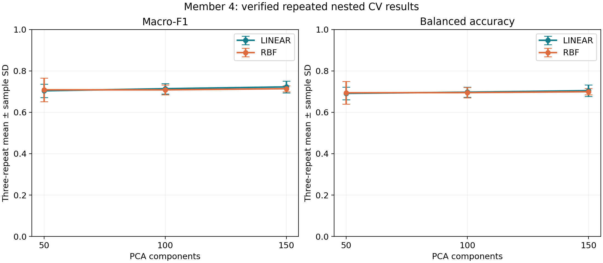
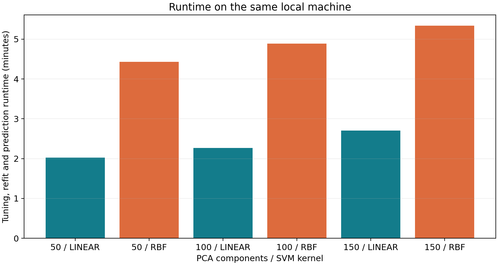
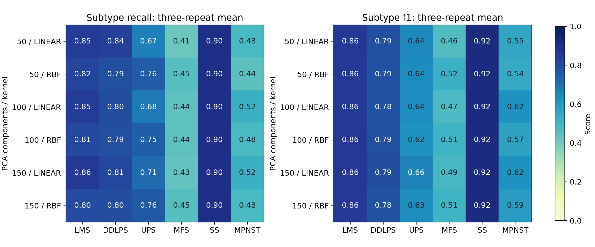
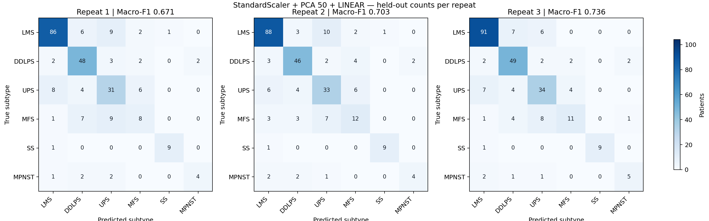
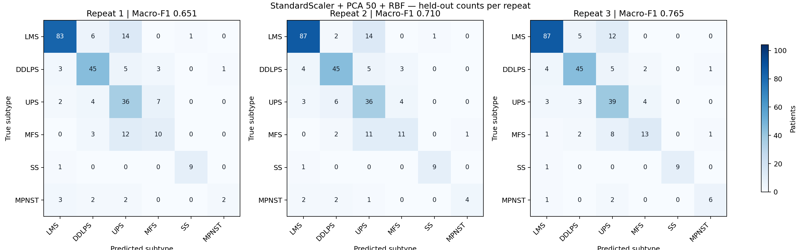
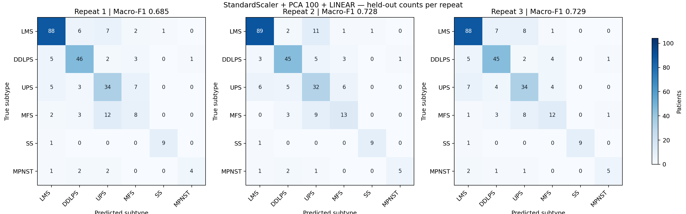
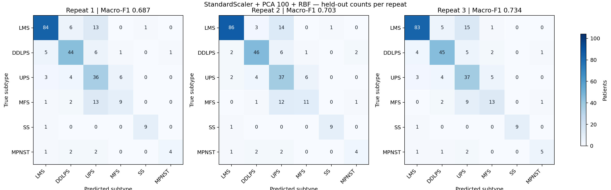
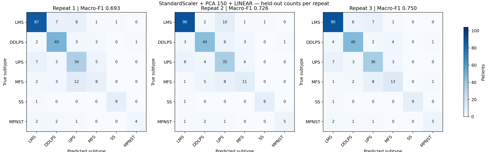
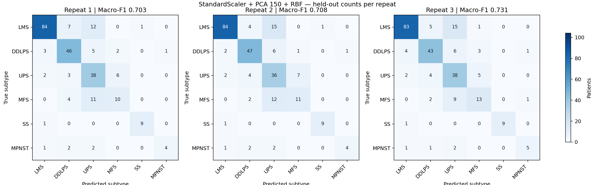

# Vy — Member 4 experiment report

Agreed code commit: `2d14aa920a8f4dec5fe0fbe364a43c17222e294d`. All six official configurations completed and passed the independent repository validator. Team-leader acceptance and peer reproduction are pending.

## Data, protocol and verification

TCGA-SARC: 254 unique patients, 20,531 gene records; LMS 104, DDLPS 57, UPS 49, MFS 25, SS 10, MPNST 9. Only gene-expression columns enter the model. Raw files and shared assignments are unchanged.

Pipeline: log2(x+1) → VarianceThreshold(0) → StandardScaler → randomized PCA → SVC. Learned transforms are fitted within each inner training fold. Outer CV uses five stratified folds × three repeats; inner CV uses four shuffled stratified folds. Seeds are 42. Linear searches five C values; RBF searches their cross-product with four gamma choices. Selection uses mean inner macro-F1 and the declared first-candidate tie rule.

C = [0.01, 0.1, 1, 10, 100]; RBF gamma = ["scale", 0.001, 0.01, 0.1]. PCA uses randomized SVD, no whitening, iterated power 7, oversamples 10 and QR normalization. BLAS threads remain 1. PCA dimensions denote components, not selected genes. The complete shared settings are preserved in every config.json.

Python 3.12.13 and all six numerical packages match the pinned versions. All 19 existing tests passed. Both smoke checks passed. Six official runs contain 90 complete outer refits and 4,572 held-out predictions in total; each has 15 refits and 762 predictions. The six searches require 4,590 pipeline fits under the declared grids. Every independent validation report passed, and every warnings.log is empty.

On macOS, preparation produced LF TSV line endings while the reviewed manifests describe CRLF bytes. The LF file was preserved, and only its serialization was restored after proving the CRLF conversion exactly matched the reviewed SHA-256. Source-value comparisons and exact seed-derived outer/inner equality passed. No code, settings, raw measurements, labels or assignments were changed. The helper preparation step was bypassed using external orchestration of the original runner, validator and run-kit export functions.

## Comparison

| PCA | Kernel | Macro-F1 mean ± sample SD | Balanced accuracy mean ± sample SD | Runtime (s) | PCA variance retained (mean) |
|---:|---|---:|---:|---:|---:|
| 50 | LINEAR | 0.7037 ± 0.0324 | 0.6912 ± 0.0298 | 121.5 | 67.215% |
| 50 | RBF | 0.7086 ± 0.0573 | 0.6943 ± 0.0554 | 266.0 | 67.215% |
| 100 | LINEAR | 0.7141 ± 0.0253 | 0.6972 ± 0.0248 | 136.2 | 83.066% |
| 100 | RBF | 0.7084 ± 0.0239 | 0.6950 ± 0.0250 | 293.5 | 83.066% |
| 150 | LINEAR | 0.7227 ± 0.0286 | 0.7047 ± 0.0275 | 162.1 | 93.055% |
| 150 | RBF | 0.7140 ± 0.0145 | 0.6994 ± 0.0155 | 320.6 | 93.055% |

Highest observed Member 4 mean macro-F1: **PCA 150 / LINEAR**, 0.7227. This ranking is exploratory, not independent final-model validation.

At PCA 50, RBF minus Linear mean macro-F1 is +0.0049; runtime ratio RBF/Linear is 2.19.
At PCA 100, RBF minus Linear mean macro-F1 is -0.0057; runtime ratio RBF/Linear is 2.15.
At PCA 150, RBF minus Linear mean macro-F1 is -0.0087; runtime ratio RBF/Linear is 1.98.

Within LINEAR, the highest observed mean macro-F1 occurs at PCA 150: 0.7227. PCA 50/100/150 scores are 0.7037, 0.7141, 0.7227.
Within RBF, the highest observed mean macro-F1 occurs at PCA 150: 0.7140. PCA 50/100/150 scores are 0.7086, 0.7084, 0.7140.

## Per-subtype findings

| PCA | Kernel | MPNST recall / F1 | SS recall / F1 |
|---:|---|---:|---:|
| 50 | LINEAR | 0.4815 / 0.5516 | 0.9000 / 0.9158 |
| 50 | RBF | 0.4444 / 0.5369 | 0.9000 / 0.9158 |
| 100 | LINEAR | 0.5185 / 0.6210 | 0.9000 / 0.9158 |
| 100 | RBF | 0.4815 / 0.5655 | 0.9000 / 0.9158 |
| 150 | LINEAR | 0.5185 / 0.6210 | 0.9000 / 0.9158 |
| 150 | RBF | 0.4815 / 0.5893 | 0.9000 / 0.9158 |

MPNST has nine patients and SS has ten in each repeat. Their estimates are sensitive to individual errors; the same patients appear across repeats. Full precision/recall/F1 tables are in member4_subtypes.csv.

## Confusion matrices

Each panel is one complete repeat of 254 held-out patients. Rows are true labels and columns are predicted labels. These matrices are not pooled across repeats.

For the highest observed Member 4 mean-F1 configuration, SVM-STD-PCA-150-LINEAR, the most frequent off-diagonal errors in each repeat are:

Repeat 1: MFS → UPS: 12 patients; LMS → UPS: 8 patients; UPS → LMS: 7 patients.
Repeat 2: LMS → UPS: 10 patients; MFS → UPS: 8 patients; UPS → LMS: 6 patients.
Repeat 3: MFS → UPS: 8 patients; UPS → LMS: 7 patients; LMS → UPS: 7 patients.

## Reproducibility and limitations

Macro-F1 and balanced accuracy are first calculated from all 254 held-out predictions separately for each repeat. Reported SD is the sample SD of three repeat scores, not SD across 15 folds and not a confidence interval. Outer results are not used for inner hyperparameter selection. No independent test cohort or statistical significance claim is supplied.

Runtime sums manifest fold runtimes (tuning, refit and prediction). It excludes preflight, validation and report generation and depends on hardware. Execution was local macOS arm64. Charts were generated in a separate reporting environment, without modifying experiment dependencies.

The validator independently recomputes metrics and checks identities, search evidence, source/code/split hashes and training-fold retention. It does not reproduce every model fit. Leakage assurance combines the reviewed pipeline, passing isolation tests, verified splits and recorded evidence; peer reproduction is still required.

All official runs succeeded; two earlier smoke runs remain smoke_only and are excluded from the score comparison. Six ZIP archives and required submission notes are in the reviewed clone results/svm/member4_exports. No external submission was sent.

## Verified run register

| Configuration | Run ID | Validation |
|---|---|---|
| SVM-STD-PCA-50-LINEAR | 20261012T081211Z-86571a08 | passed; 15 folds; 762 predictions |
| SVM-STD-PCA-50-RBF | 20261012T081542Z-3c8299aa | passed; 15 folds; 762 predictions |
| SVM-STD-PCA-100-LINEAR | 20261012T082128Z-85f53858 | passed; 15 folds; 762 predictions |
| SVM-STD-PCA-100-RBF | 20261012T082505Z-4ec7d6b6 | passed; 15 folds; 762 predictions |
| SVM-STD-PCA-150-LINEAR | 20261012T083452Z-429d7bb1 | passed; 15 folds; 762 predictions |
| SVM-STD-PCA-150-RBF | 20261012T083854Z-1beab531 | passed; 15 folds; 762 predictions |
