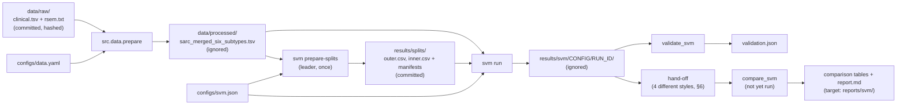

# Architecture

Snapshot of `main` at commit `624402a` (13 October 2026). This document describes the repository as it is, lists what is untidy or duplicated, and proposes a target layout for three products: **experiments**, **paper**, and **app**. No code has been changed. Section 9 lists the decisions the team needs to make before any restructuring starts.

## 1. What the system does

The repository predicts six sarcoma subtypes (LMS, DDLPS, UPS, MFS, SS, MPNST) from TCGA-SARC gene expression. It has 254 patients, 20,531 gene features, and one sample per patient. The current round compares 24 SVM pipelines under one shared nested cross-validation protocol (protocol 2.0):

- Outer loop: 5 stratified folds × 3 repeats, seed 42. Each repeat gives one held-out prediction per patient.
- Inner loop: 4 stratified folds inside each outer training set, seed 42. GridSearch picks the parameters with the best mean macro-F1.
- Pipeline: `log2(x+1) → VarianceThreshold(0) → MinMax|Standard scaler → ANOVA|PCA (k = 50/100/150) → SVC (linear|rbf)`.

Each team member runs 6 of the 24 configurations. A separate validator checks every run, and a comparison tool combines 24 accepted runs.

## 2. Modules

| Module | Responsibility | Reads | Writes | Entry point |
| --- | --- | --- | --- | --- |
| [src/data/audit.py](../src/data/audit.py) | Loads `configs/data.yaml`, then checks the raw inputs without changing them: IDs, non-negative values, class counts, hashes | `data/raw/*` | stdout JSON | `python -m src.data.audit` |
| [src/data/prepare.py](../src/data/prepare.py) | Matches expression to clinical labels, transposes the matrix, names gene columns `gene__SYMBOL__ENTREZ__rowN`, and checks the saved file | `data/raw/*` | `data/processed/*.tsv`, `merge_validation.json`, `README.md` | `python -m src.data.prepare` |
| [src/experiments/common.py](../src/experiments/common.py) | Checks the environment (Python 3.12 and pinned packages), loads the dataset and checks it value by value against the raw files, creates and verifies the outer splits | processed TSV, raw files, `results/splits/outer*` | `results/splits/outer.csv`, `outer_manifest.json` (only on `prepare-splits`) | library |
| [src/experiments/validation.py](../src/experiments/validation.py) | Generates outer splits with `RepeatedStratifiedKFold`, checks them for leakage and completeness, and turns split rows into fold indices | DataFrames | — | library |
| [src/experiments/pipeline.py](../src/experiments/pipeline.py) | Builds a fresh sklearn `Pipeline` for each fit and records the features each fold kept or selected | config dicts | — | library |
| [src/experiments/metrics.py](../src/experiments/metrics.py) | Computes per-repeat macro-F1, balanced accuracy, per-class P/R/F1, and confusion matrices, plus the mean and sample SD across repeats | predictions DataFrame | dict | library |
| [src/experiments/svm.py](../src/experiments/svm.py) | **Runner and CLI.** Inner-split generation and checks, parameter grid, GridSearch with a cache, outer-fold loop, provenance, and the run-folder writer | `configs/svm.json`, dataset, splits | `results/svm/<CONFIG>/<RUN_ID>/*`, `results/splits/inner*` | `python -m src.experiments.svm {list,check,prepare-splits,run}` |
| [src/experiments/validate_svm.py](../src/experiments/validate_svm.py) | Audits a finished run without the runner's metric code. It recomputes metrics from predictions, re-checks the search winner, and checks data, split, and code hashes | run folder, dataset, splits | `validation.json` (`--report`) | `python -m src.experiments.validate_svm RUN_DIR` |
| [src/experiments/compare_svm.py](../src/experiments/compare_svm.py) | Validates exactly 24 selected runs again and writes the comparison tables and `report.md` | `selection.json`, 24 run folders | new output folder | `python -m src.experiments.compare_svm SEL --output DIR` |
| [notebooks/01_data_exploration.ipynb](../notebooks/01_data_exploration.ipynb) | Describes the data: cohort, distributions, duplicate gene IDs, label consistency | `configs/data.yaml`, `data/processed/*` | — (in-notebook outputs) | Jupyter |
| [tests/](../tests) | Leakage tests (test values cannot change fitted preprocessing), split tests, metric tests, validator rejection tests, and comparison gates | `configs/svm.json`, synthetic data | — | `python -m unittest discover -s tests -v` |

How the modules depend on each other:

```text
audit ◄── prepare
validation ◄── common ◄── svm ◄── validate_svm ◄── compare_svm
pipeline  ◄───────────────┘
metrics   ◄───────────────┘
```

Note that `validate_svm` and `compare_svm` import from `svm`, the runner. This means the inner-split logic lives in the SVM runner rather than in a shared module.

## 3. Data flow: raw → prepare → splits → runner → metrics → reports



### 3.1 Raw → prepared

1. `audit()` checks both raw files: unique IDs, numeric values that are non-negative and finite, the expected class counts, and SHA-256 hashes.
2. `prepare()` keeps samples whose `Cancer Type Detailed` is one of the six subtypes and maps each to a short code. It transposes expression to one row per sample and names each feature with its source row so that duplicate symbols stay separate. No learned preprocessing is applied.
3. It writes six TSVs plus `merge_validation.json` and a generated `README.md` into `data/processed/`.

### 3.2 Prepared → splits

`python -m src.experiments.svm prepare-splits` is run once by the leader:

- `common.shared_splits` writes `outer.csv` (762 rows = 254 × 3 repeats). Its manifest records `dataset_sha256`, the source hashes, the validation settings, and the scikit-learn version.
- `svm.shared_inner` writes `inner.csv` (3,048 rows). Its manifest records `dataset_sha256`, `outer_sha256`, and the inner settings.
- Every later command regenerates the splits from the seed and requires them to match the saved files exactly (`DataFrame.equals`). A rewritten manifest therefore cannot hide edited assignments.

### 3.3 Runner

For each configuration and each of the 15 outer folds, `run_configuration`:

1. Builds the inner CV indices from `inner.csv`.
2. Runs `GridSearchCV` over the pipeline with a joblib `Memory` cache in a temporary folder. The cache reuses preprocessing across C/gamma candidates within one fold only.
3. Treats any warning as a failure. Records `best_params`, all candidate scores, per-fold features, and the outer predictions.
4. Rewrites `run_manifest.json`, `feature_details.json`, `search_results.json`, `predictions.csv`, and `warnings.log` after every fold, so a crash leaves partial evidence.
5. Writes `metrics.json` at the end, but only if all 15 folds completed.

Official runs require a clean Git working tree (`git_dirty == False`). `--smoke` stops after one fold. `--development` allows a dirty tree.

### 3.4 Metrics, validation, comparison

- `metrics.summarize` scores **per repeat**, pooling all 254 held-out predictions, and then takes the mean and sample SD across the 3 repeats. It does not average over folds.
- `validate_svm.audit_run` recomputes the confusion matrix, F1, and recall by hand, and compares them with `metrics.json` at a tolerance of 1e-12. It also re-checks the search winner and the training-fold retained genes, and requires the **current** training-code hashes to equal those recorded in the run.
- `compare_svm` requires one run per configuration (24), all from **the same `git_commit`** with a clean tree. It writes `overall_scores`, `repeat_scores`, `subtype_repeat_scores`, `subtype_summary`, `confusion_matrices`, `selected_parameters`, `selection.json`, `comparison_manifest.json`, and `report.md`.

### 3.5 Integrity chain (what is hashed where)

```text
raw files ──sha256──► configs/svm.json:source_sha256 ──► every manifest
processed TSV ──sha256 (bytes)──► outer_manifest, inner_manifest, run_manifest:dataset_sha256
outer.csv ──sha256──► outer_manifest:split_sha256, inner_manifest:outer_sha256, run_manifest:split_sha256
inner.csv ──sha256──► inner_manifest, run_manifest:inner_split_sha256
src/experiments/{__init__,common,validation,pipeline,metrics,svm}.py + configs/svm.json
          + requirements-experiments.txt ──sha256──► run_manifest:code_sha256
```

This chain is the project's main strength, and also the main obstacle to refactoring (§5.3).

## 4. Where outputs are stored

| Path | In Git? | Produced by | Contents |
| --- | --- | --- | --- |
| `data/raw/` | yes (byte-preserved by `.gitattributes`) | external download | 2 source files, about 44 MB |
| `data/processed/` | no | `src.data.prepare` | merged TSVs, maps, exclusion logs, `merge_validation.json` |
| `results/splits/` | **yes** (exception in `.gitignore`) | `svm prepare-splits` | outer/inner assignments + manifests |
| `results/svm/<CONFIG>/<RUN_ID>/` | no | `svm run` | full run folder (about 11 MB each, mostly `feature_details.json`) |
| `results/svm/comparison/` (per docs) | no | `compare_svm` | comparison tables |
| `reports/svm/` (per docs) | yes | manual copy after review | accepted comparison. **Does not exist yet** |
| `reports/member4/` | yes | Member 4, external scripts | report, charts, CSVs, run excerpts, logs, checksums |
| `submissions/member1/` | yes | Member 1 | **full** run folders including `feature_details.json` (about 67 MB), logs, 2 index files |
| `submissions/member2/` | yes | Member 2 | README, TLDR report, validator outputs saved as `.log` |
| `submissions/member3/` | yes | Member 3 | README, console logs (setup/check/smoke/run/validate) |
| `docs/submission_register.csv` | yes | reviewer | **header only; no rows** |
| team shared drive | — | Members 2, 3, 4 | ZIP archives of full run folders (not reachable from the repo) |

## 5. Where the code is tied to SVM

### 5.1 Coupling in code

| Location | What is SVM-specific | What a generic version needs |
| --- | --- | --- |
| [pipeline.py:32](../src/experiments/pipeline.py#L32) | The final step is always `SVC(kernel=…, **settings["model"])` | a model registry: `family → estimator factory` |
| [svm.py:29-33](../src/experiments/svm.py#L29-L33) `candidates()` | The grid is `model__C`, plus `model__gamma` only when the kernel is `rbf` | a grid declared per family in config |
| [svm.py](../src/experiments/svm.py), whole file | Generic nested-CV logic (`generate_inner`, `shared_inner`, `inner_indices`, `fit_search`, `run_configuration`, `provenance`) sits in the SVM module | split into `splits` + `runner` + `provenance` modules |
| [svm.py:23-24](../src/experiments/svm.py#L23-L24) vs [common.py:12-13](../src/experiments/common.py#L12-L13) | Inner split paths live in `svm.py`, outer split paths in `common.py` | one splits module |
| [svm.py:27](../src/experiments/svm.py#L27) | The config path is hard-coded to `configs/svm.json` | `--config` / `--round` argument |
| [svm.py:86-87](../src/experiments/svm.py#L86-L87), [validate_svm.py:40](../src/experiments/validate_svm.py#L40) | The list of hashed "training files" names `svm.py` and is repeated in two places | one constant, derived from the package |
| [svm.py:112](../src/experiments/svm.py#L112) | The output root is `results/svm/` | `results/<round>/` |
| [svm.py:166](../src/experiments/svm.py#L166) | `--member` is limited to 1-4, and the config stores an `owner: "Member N"` field | keep assignments outside the experiment config |
| [validate_svm.py:52](../src/experiments/validate_svm.py#L52), [:59](../src/experiments/validate_svm.py#L59), [:64](../src/experiments/validate_svm.py#L64) | Literal `15` outer fits and `4` inner folds | derive from `validation` / `inner_validation` |
| [compare_svm.py:14-16](../src/experiments/compare_svm.py#L14-L16) | Exactly `24` configurations; the report title is "SVM experiment comparison" | read from the round config; allow comparisons across rounds |
| `configs/svm.json` | Shared protocol settings (dataset, CV, preprocessing, PCA, package pins) are mixed with SVM settings (`model`, `search`, `configurations`, `round`) | `protocol.json` + `rounds/<family>.json` |
| `settings["model"]` | `probability: false`. The model returns no probabilities or calibrated scores | the app will need scores (§8, D11) |
| [tests/test_svm.py:27-34](../tests/test_svm.py#L27-L34) | Asserts 24 configurations, 6 per member, and 4,590 fits | per-round tests |
| `docs/templates/svm_comparison_selection.json`, every file in `docs/` | Titles, commands, and counts are all written for SVM | split into protocol docs and per-round docs |

The parts that are **already generic**: `validation.py`, `metrics.py`, most of `common.py`, the preprocessing steps in `pipeline.py`, and `feature_details` (it only depends on the step names `variance` and `reduction`).

### 5.2 Assumptions tied to a platform or the environment

- **Byte-level dataset hash vs line endings.** [prepare.py:59](../src/data/prepare.py#L59) calls `to_csv` without `lineterminator`, so pandas writes CRLF on Windows and LF on macOS/Linux. The committed manifests record the Windows (CRLF) hash, so `svm check` fails on macOS and Linux after a fresh `prepare`. Member 4 worked around this by restoring the CRLF bytes and running the tools from outside the repository (see `reports/member4/README.md`).
- [svm.py:80](../src/experiments/svm.py#L80) hard-codes the path `C:\Program Files\Git\cmd\git.exe`.
- Python must be exactly 3.12, and all 6 numerical packages must match their pins exactly.
- The README and docs show PowerShell commands only.

### 5.3 The validator checks code at HEAD

`audit_run` requires the hash of each training file **in the current working tree** to equal the hash recorded in the run. Once any of those six `.py` files or `configs/svm.json` changes, none of the existing 24 runs can be validated or compared from HEAD. They would have to be validated from a checkout of their original commit. **Every refactor must therefore wait until the SVM comparison has been produced and tagged.** See D1 and the sequencing in §8.

## 6. Untidy or duplicated areas

### 6.1 Run evidence is stored in four different ways

| Member | Location | Full run folder in Git? | `validation.json` | Report | Commit used |
| --- | --- | --- | --- | --- | --- |
| 1 (MM+ANOVA) | `submissions/member1/runs/…` | **yes, about 67 MB** | inside each run | `README.md` + `submission.md` (nearly identical tables) | `2d14aa9` |
| 2 (STD+ANOVA) | `submissions/member2/` | no (ZIPs on the drive) | as `logs/validate_*.log`, with absolute `D:\` paths | `README.md` + `TLDR_REPORT.md` | `5d90767` |
| 3 (MM+PCA) | `submissions/member3/` | no (ZIPs on the drive) | only inside console logs | `README.md` (macro-F1 only) | `5d90767` |
| 4 (STD+PCA) | **`reports/member4/`** | excerpt **without** `feature_details.json` | inside the excerpt | report, charts, CSVs, register, checksums | `2d14aa9` |

Specific problems:

1. **Two training commits.** Members 2 and 3 used `5d90767`; Members 1 and 4 used `2d14aa9`, which is the merge commit of Member 3's PR. `git diff 5d90767 2d14aa9 -- src configs tests` is empty, so the code is identical. However, [compare_svm.py:26](../src/experiments/compare_svm.py#L26) requires a single `git_commit`, so **the comparison of all 24 runs cannot run as the tool is written.**
2. Member 1 committed full run folders, against `docs/submission_requirements.md` and `docs/combining_results.md`. Git history now holds about 67 MB that will stay there even after a delete.
3. Member 4's results are in `reports/`, which `reports/README.md` reserves for the accepted *team* comparison in `reports/svm/`. That README still says "No accepted comparison results are available yet".
4. `docs/submission_register.csv` is empty, although four members have submitted.
5. Member 4's charts and CSVs were produced by "run-kit export functions" and a separate plotting environment that are **not in the repository**, so nobody can regenerate them. Members 2 and 3 typed their tables by hand. The four tables use different columns and precision (3 or 4 decimals; Member 3 reports no balanced accuracy).
6. Member 1's numbered setup logs were regenerated after a merge conflict (their `00_summary.log` says so). That is honest, but these logs are not original evidence.
7. Logs from Members 2 and 3 contain absolute Windows paths and a local folder name.

### 6.2 Documentation

| Content | Repeated in |
| --- | --- |
| Setup commands (venv, pip, prepare, check, unittest) | `README.md`, `docs/running_experiments.md`; also implied in `docs/team_guide.md` |
| Cohort numbers (254 / 20,531 / class counts) | `README.md`, `docs/experiment_protocol.md`, `configs/data.yaml`, `configs/svm.json`, the README written by `prepare.py`, the notebook, member reports |
| Member assignment (scaler × reduction per member) | `configs/svm.json`, `docs/experiment_protocol.md` (table), `docs/experiment_tree.md` (tree), `docs/running_experiments.md` (prose) |
| Workload counts (18,360 fits, 4,590 per member, 762 predictions) | protocol, tree, `README.md`, tests |
| "Don't silently pick the best rerun", the register, review statuses | `submission_requirements.md`, `combining_results.md` |
| Source hashes | `DATA_SOURCES.md`, `configs/svm.json`, every manifest |
| Where outputs go | `README.md` table, `team_guide.md`, `reports/README.md`, `combining_results.md`. These disagree with each other and with what members actually did |

Other documentation problems:

- `docs/team_guide.md` is only an index into the other five docs. `docs/experiment_tree.md` is a 60-line drawing of the same table as the protocol.
- `docs/combining_results.md` writes the comparison to `results/svm/comparison`, then asks for a manual copy to `reports/svm/`. The copy step is not documented.
- `.gitignore` ignores `/reports/validation/` and `/docs/svm_validation.md` ("private development verification records"), which are not mentioned anywhere else.
- `configs/data.yaml` is JSON with a `.yaml` extension. The README has to explain this.

### 6.3 Code

- The gene-name formula is written twice: [prepare.py:34](../src/data/prepare.py#L34) and [common.py:60](../src/experiments/common.py#L60).
- `configs/data.yaml` is loaded twice in different ways: `audit.load_config` resolves paths, while [common.py:56](../src/experiments/common.py#L56) parses the file directly.
- Labels and class counts appear in both `data.yaml` and `svm.json`.
- `audit()` and `prepare()` repeat the same checks (as exceptions in one and asserts in the other).
- [validate_svm.py:11](../src/experiments/validate_svm.py#L11) imports `provenance` and never uses it.
- `results/splits/` holds protocol **inputs** inside a folder that is otherwise ignored scratch output. The `.gitignore` needs four exception lines to support this.
- There are three requirements files and no `pyproject.toml`. `src` is imported as a top-level package named `src`.
- Nothing fits and saves a final model. The runner keeps only predictions, which the app product will need to change (§7.4).

## 7. Proposed target structure for three products

### 7.1 Principles

1. **One engine, three consumers.** The experiment engine (`src/sarc/`) is the only code that fits models. The paper and the app read only **committed, versioned artifacts** produced by it: comparison tables, figures, and the final-model bundle. They never import the runner.
2. **Rounds are data, not code.** A round (SVM, RF, …) is a config file plus a folder of accepted evidence. Adding a model family means adding one registry entry and one config, with no new runner, validator, or comparison module.
3. **Three storage tiers:** `results/` is local scratch and ignored. `experiments/<round>/` holds curated, compact, committed evidence. Large archives go to one external store, with SHA-256 hashes in the register.
4. **One source of truth per fact.** Cohort numbers come from `configs/data.json`, CV settings from `configs/protocol.json`, and assignments from the round register. Docs link to these files instead of copying numbers.
5. **Every figure and table can be regenerated** by committed code (`src/sarc/reporting`).

### 7.2 Target tree

```text
ProjectA/
├── README.md                      # one page: purpose, the 3 products, links
├── pyproject.toml                 # package `sarc`; extras: experiments | notebooks | paper | app
├── configs/
│   ├── data.json                  # cohort definition (was data.yaml)
│   ├── protocol.json              # dataset, outer/inner CV, scoring, preprocessing, env pins
│   └── rounds/
│       ├── svm.json               # family, grid, configurations (no owners)
│       └── <family>.json
├── data/
│   ├── raw/                       # unchanged
│   ├── processed/                 # ignored
│   └── splits/                    # outer/inner + manifests (moved from results/splits)
├── src/sarc/
│   ├── data/        audit.py · prepare.py · features.py (gene naming, defined once)
│   ├── protocol/    environment.py · integrity.py · splits.py (outer + inner) · provenance.py
│   ├── models/      registry.py · svm.py · …        # estimator factory + grid per family
│   ├── pipeline.py                # preprocessing + model from registry
│   ├── runner.py                  # nested CV, run-folder writer
│   ├── metrics.py
│   ├── audit_run.py               # independent validator (counts from config)
│   ├── compare.py                 # within a round and across rounds
│   ├── reporting/   tables.py · figures.py          # used by member notes, paper, app
│   ├── final_model.py             # fit the chosen config on the full cohort → bundle
│   └── cli.py                     # `sarc prepare | splits | run | validate | compare | report | final`
├── experiments/                   # ── PRODUCT 1 ──
│   └── svm-p2.0/
│       ├── README.md              # status, commit(s), headline table (generated)
│       ├── register.csv           # one row per submitted run + review status + archive sha
│       ├── selection.json
│       ├── runs/<CONFIG>/<RUN_ID>/        # compact excerpt (no feature_details) + validation.json + submission.md
│       ├── comparison/            # compare output, unedited
│       └── notes/member{1..4}.md  # optional narrative (current TLDR / member4 report)
├── paper/                         # ── PRODUCT 2 ──
│   ├── manuscript/  main.(tex|qmd) · sections/ · refs.bib
│   ├── figures/     # generated by `sarc report --paper`
│   ├── tables/      # generated
│   └── Makefile     # build = regenerate figures/tables from experiments/*/comparison, then compile
├── app/                           # ── PRODUCT 3 ──
│   ├── README.md · MODEL_CARD.md  # intended use, "research only, not clinical", data notice
│   ├── service/predict.py         # load bundle, align genes via gene map, return class + scores
│   ├── ui/                        # Streamlit or web front end (D10)
│   ├── bundle/                    # ignored; fetched from release by checksum
│   └── tests/
├── docs/
│   ├── architecture.md
│   ├── protocol.md                # shared rules (data, leakage, nested CV, acceptance)
│   ├── workflow.md                # run → validate → submit → review → compare (one doc)
│   ├── rounds/svm.md              # round-specific grid + assignment table
│   ├── decisions/ADR-*.md
│   └── templates/
├── notebooks/
├── tests/   unit/ · integration/
└── results/                       # ignored scratch: full runs, smoke runs, exports
```

### 7.3 How the products connect

```text
configs/ + data/ ──► src/sarc (runner) ──► results/ (scratch)
                                     │
                         audit_run + review
                                     ▼
                 experiments/<round>/{runs,register,comparison}
                     │                               │
       sarc report --paper                 sarc final --round … --config …
                     ▼                               ▼
          paper/figures, paper/tables       bundle (model.joblib + manifest + gene map)
                     ▼                               ▼
               manuscript PDF                 app/service → app/ui
```

### 7.4 Product-specific notes

**Experiments.** The current runner, validator, and protocol carry over mostly unchanged in structure. What changes is generality: model family, fold counts, and the number of configurations come from config. The compare gate checks `code_sha256` equality rather than requiring the same commit (D1).

**Paper.** Nested CV estimates performance, but choosing the best of 24+ configurations by outer score adds selection bias, as `combining_results.md` already warns. The paper needs a stated plan for this: report all configurations, treat the winner as a candidate, and optionally validate it externally. Every number in the manuscript should come from a generated table, not be typed by hand.

**App.** Nothing in the repository produces a deployable model yet. The app needs:

1. A final-model procedure. One option is to refit the chosen configuration on all 254 patients, with its parameters tuned by CV on the full cohort.
2. Scores. Either `probability=True` or decision-function outputs, plus a calibration choice.
3. An input contract. RSEM values in the 20,531-gene layout, aligned through `gene_feature_map`. The app also needs a rule for missing or extra genes.
4. A bundle manifest that links the model to its round, commit, and protocol hashes.
5. A licence check before distributing a model trained on TCGA data.

## 8. Suggested order of work (no code changes in this step)

| Phase | Work | Touches training code? |
| --- | --- | --- |
| 0 (now) | This document; team agrees on §9 | no |
| 1 | Close the SVM round on the **current** code: resolve D1, collect 24 run folders, run `compare_svm`, fill the register, tag `svm-p2.0` | no (or only `compare_svm.py`, which is not in the hashed training set) |
| 2 | Housekeeping: move `submissions/*` and `reports/member4` into `experiments/svm-p2.0/` in one layout, consolidate docs, clean `.gitignore`, commit the member-4 chart scripts if they are kept | no |
| 3 | Refactor into `src/sarc` (registry, generic runner, config split, CRLF fix, relocated splits). Protocol 3.0: regenerate manifests once and record the new dataset hash | **yes**. Older runs are then validated only from tag `svm-p2.0` |
| 4 | Further model rounds, paper skeleton plus report generation, final-model command, app MVP | yes |

## 9. Decisions needed

| ID | Decision | Options | Recommendation | Blocks |
| --- | --- | --- | --- | --- |
| D1 | Two training commits (`5d90767` for Members 2 and 3, `2d14aa9` for Members 1 and 4), identical code | (a) relax the compare gate to equal `code_sha256` + clean tree; (b) Members 2 and 3 rerun on `2d14aa9`; (c) Members 1 and 4 rerun on `5d90767` | (a). The code is byte-identical and the manifests already record the code hashes. Record the change in an ADR | Phase 1 |
| D2 | Where full run folders (about 11 MB each) live | team drive ZIPs; Git LFS; GitHub Release assets; in Git | One external store (Release or drive) plus `archive_sha256` in the register; Git keeps only compact excerpts | Phase 1-2 |
| D3 | Member 1's 67 MB in Git history | leave history alone and remove from the tip; rewrite history (filter-repo + force-push) | Remove from the tip once the archive is stored. Rewrite history only if clone size becomes a real problem, because rewriting disrupts all 7 clones | Phase 2 |
| D4 | One layout for accepted evidence | keep `submissions/` + `reports/`; move everything to `experiments/<round>/` | `experiments/<round>/` with one per-run excerpt format and one generated summary table | Phase 2 |
| D5 | Who fills `submission_register.csv`, and with which statuses | leader; reviewer per PR | Reviewer fills one row per run in the merge PR; the leader confirms `accepted` | Phase 1 |
| D6 | Dataset hash and CRLF | (a) keep as is for protocol 2.0 and document a macOS/Linux workaround; (b) write `\n` always and hash bytes (new manifests); (c) hash the parsed content instead of bytes | (a) now, then (b) or (c) in protocol 3.0. Changing it now invalidates every existing manifest | Phase 1 / 3 |
| D7 | Freeze rule: may `src/experiments/*` change before the SVM comparison is tagged? | yes; no | **No.** Any change to a hashed file stops the existing runs from validating at HEAD | Phase 1 |
| D8 | Next model families and assignment pattern | e.g. LR, RF, kNN, XGBoost, MLP; keep the "each member owns a branch" split or not | Decide with the lecturers. Keep the same outer/inner splits so results stay comparable across rounds | Phase 4 |
| D9 | Paper format and location | LaTeX/Overleaf; Quarto/Markdown; separate repo | `paper/` in this repo, built from generated tables. Overleaf can sync from Git if the team prefers it | Phase 4 |
| D10 | App purpose and stack | teaching or demo (Streamlit); API + web UI; notebook-only demo | Streamlit demo labelled "research only", running locally or on a free host | Phase 4 |
| D11 | Final-model procedure for the app | refit the winner on all 254 with CV tuning; ensemble of the 15 outer models; no single model | Refit on all 254 with the same inner-style CV; calibrated scores; model card states the selection bias | Phase 4 |
| D12 | Distributing a TCGA-trained model and sample inputs | ship the bundle publicly; private release; build locally only | Check the Broad GDAC / cBioPortal terms first. Until then, build locally and ship no raw data | Phase 4 |
| D13 | Packaging | keep three requirements files; `pyproject.toml` with extras | `pyproject.toml` with extras `experiments`, `notebooks`, `paper`, `app`; the experiment pins stay exact | Phase 3 |
| D14 | Member narrative reports (Member 2 TLDR, Member 4 report and charts) | keep as notes; replace with generated per-round reports; delete | Keep as `notes/`. Commit the scripts behind them, or regenerate from `src/sarc/reporting` | Phase 2 |
| D15 | Docs consolidation | keep 6 SVM docs; protocol + workflow + per-round page | `protocol.md` + `workflow.md` + `rounds/<family>.md`; numbers linked from configs, not copied | Phase 2 |
| D16 | Language and home of the documents | Git docs only; Confluence only; both | Technical docs stay in Git (they are versioned with the code); Confluence links to them | Phase 2 |
