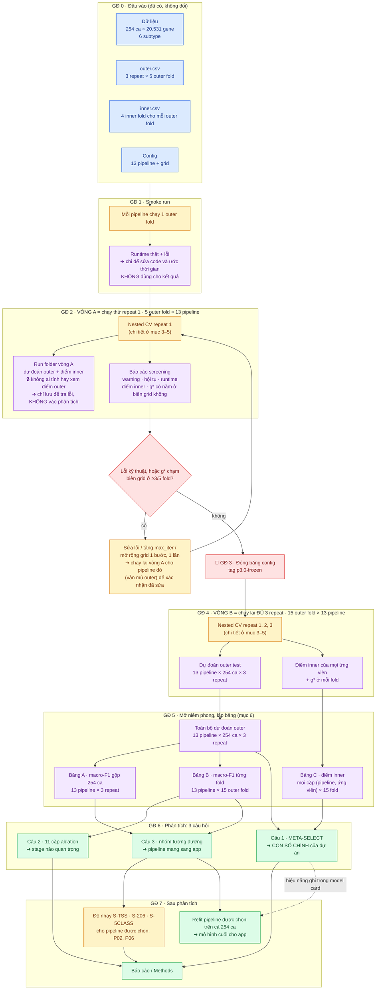
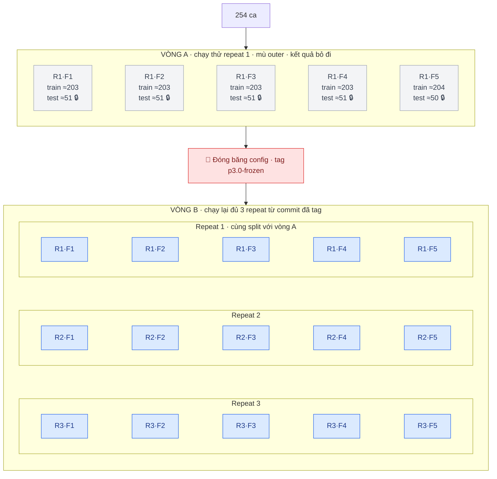
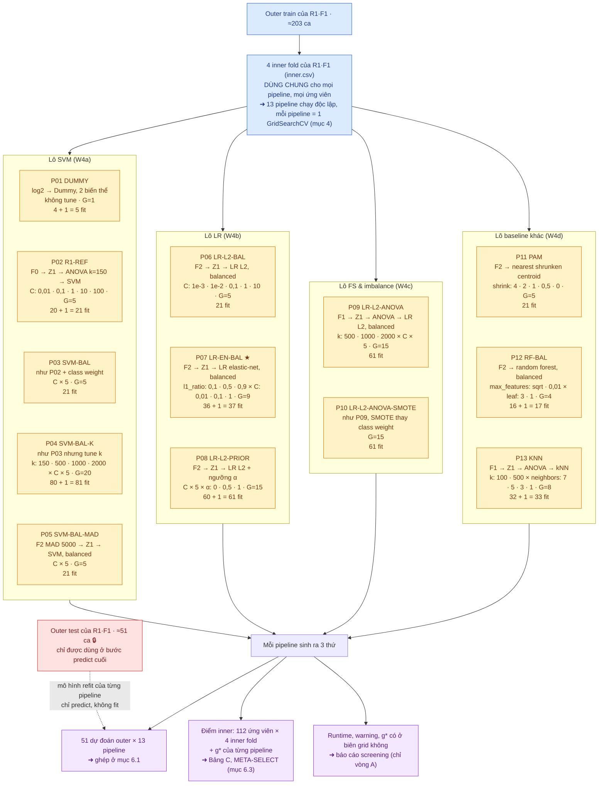
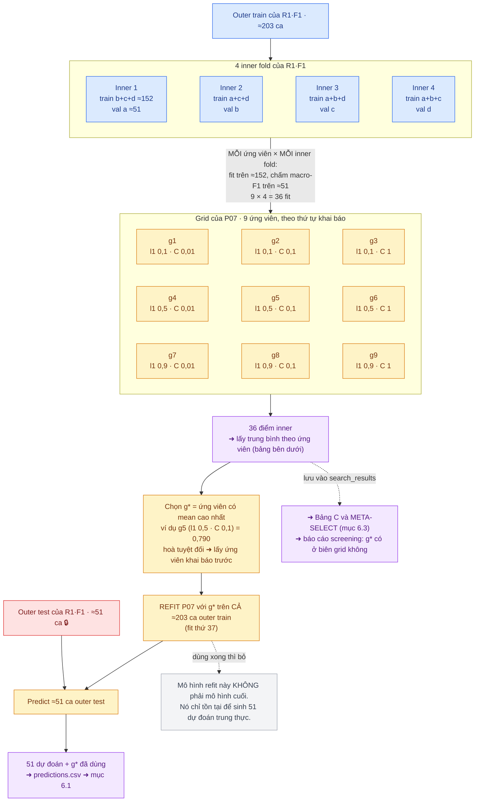
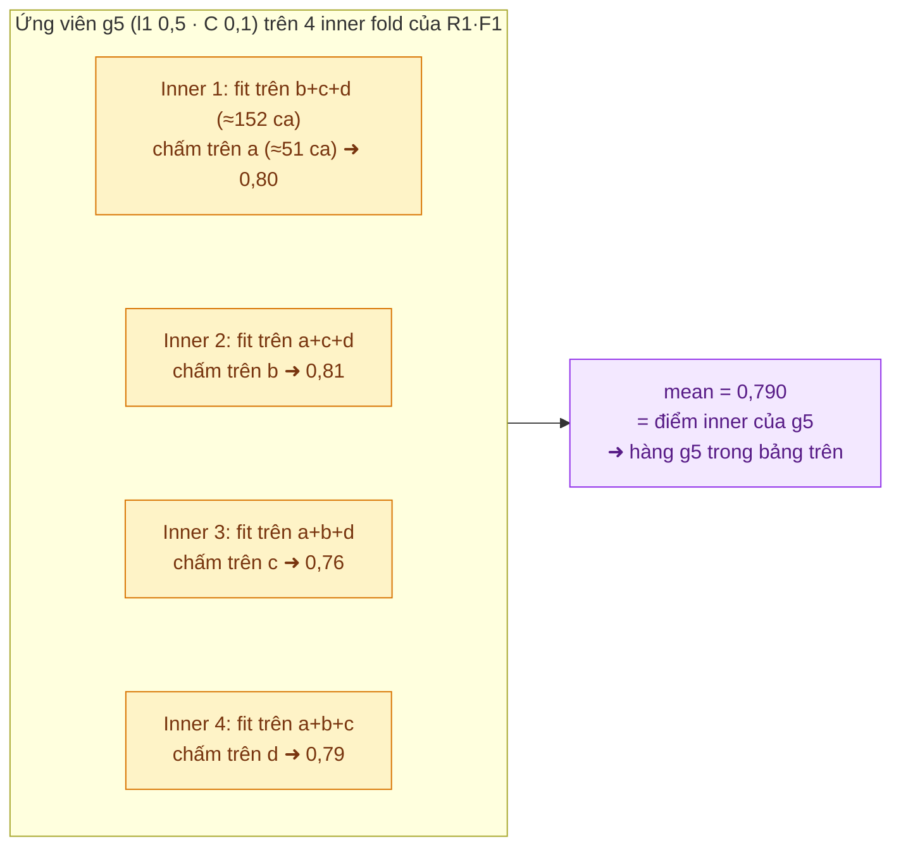
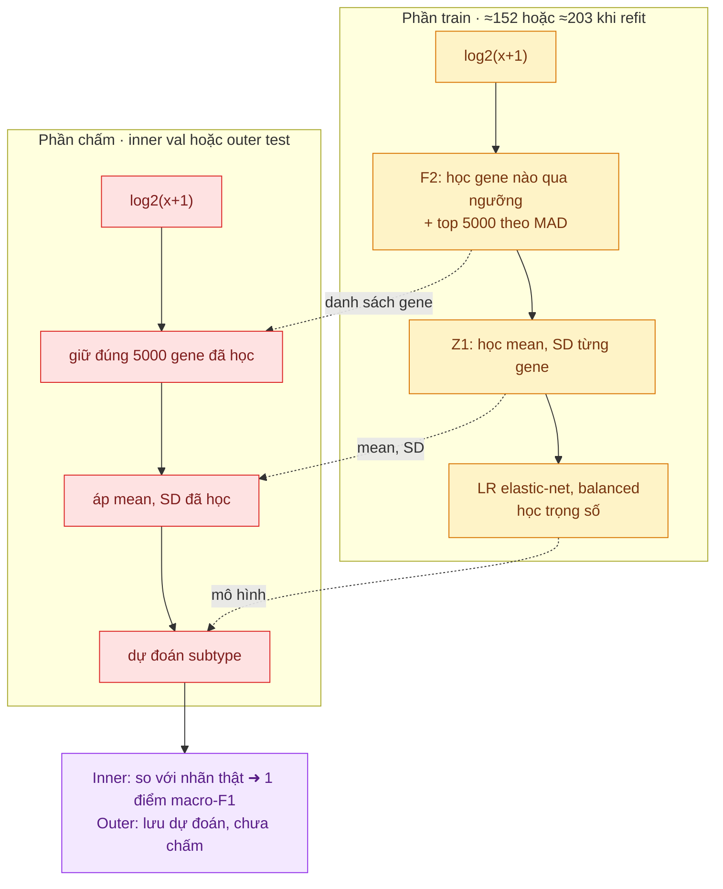
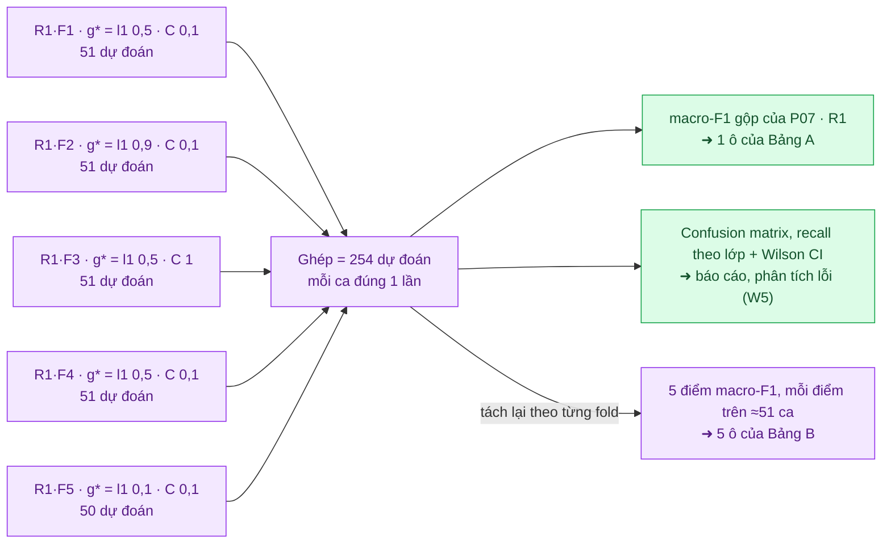
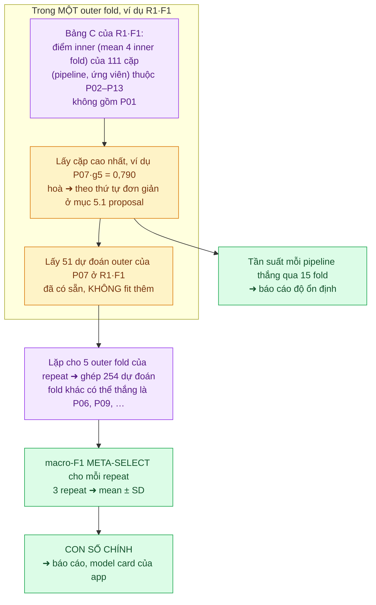
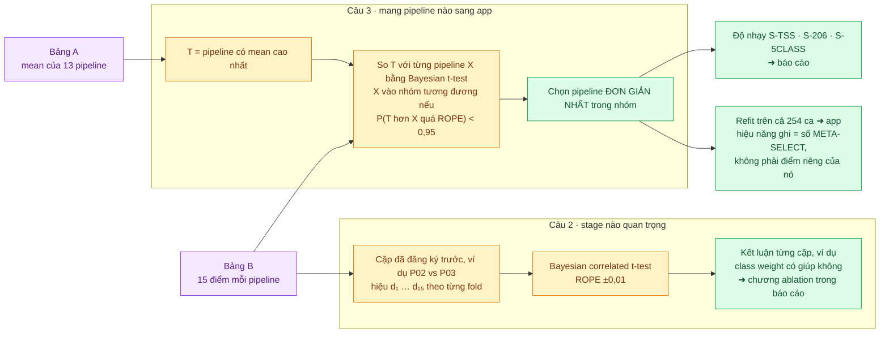

# Nested CV của Protocol 3.0: sơ đồ đầy đủ

Tài liệu đi kèm [protocol_3.0_proposal.md](protocol_3.0_proposal.md). Mục đích: chỉ cần nhìn sơ đồ là biết dữ liệu đi qua những tầng nào, mỗi tầng sinh ra gì, và thứ đó đi đâu tiếp theo. Mọi con số điểm (0,79, 0,80, …) trong ví dụ là **số minh hoạ**, không phải kết quả thật.

## Đọc nhanh trong 30 giây

- Cả dự án dùng **một** khung nested CV duy nhất: 3 repeat × 5 outer fold = **15 outer fold**. Mỗi outer fold có **4 inner fold**.
- Trong **mỗi** outer fold, **cả 13 pipeline** đều chạy, độc lập với nhau. Mỗi pipeline tự grid search trên **cùng** 4 inner fold đó.
- **Vòng A** là một lượt chạy thử repeat 1 để tra lỗi kỹ thuật, mù outer, rồi **bỏ kết quả đi**. **Vòng B** chạy lại **đủ 3 repeat** từ config đã đóng băng. Hai vòng dùng cùng một khung nested CV và cùng `outer.csv`; chỉ kết quả vòng B được phân tích.
- Điểm của một pipeline = macro-F1 trên 254 dự đoán ghép từ 5 outer test của một repeat. Tham số tốt nhất g\* có thể **khác nhau** giữa các fold.
- Con số chính của dự án là **META-SELECT**: chọn pipeline bằng điểm inner trong từng outer fold, không chọn bằng điểm outer.

**Màu dùng chung cho mọi sơ đồ:** xanh dương = đầu vào · vàng = bước chạy (có fit) · tím = output được lưu · đỏ = cổng kiểm soát hoặc dữ liệu bị khoá · xanh lá = kết quả cuối.

**Nội dung:**
[1. Toàn bộ quy trình](#1-toàn-bộ-quy-trình-theo-giai-đoạn) ·
[2. Chia dữ liệu](#2-chia-dữ-liệu-repeat-outer-fold-inner-fold) ·
[3. Trong một outer fold](#3-bên-trong-một-outer-fold-13-pipeline) ·
[4. Trong một pipeline](#4-bên-trong-một-pipeline-grid--inner-fold-ví-dụ-p07) ·
[5. Trong một lần fit](#5-bên-trong-một-lần-fit-các-stage) ·
[6. Gom kết quả](#6-gom-kết-quả-lên-từ-51-dự-đoán-tới-con-số-chính) ·
[7. Output đi đâu](#7-mỗi-output-đi-đâu) ·
[8. Đếm số lượng](#8-đếm-số-lượng) ·
[9. Hiểu nhầm](#9-những-chỗ-hay-hiểu-nhầm)

---

## 1. Toàn bộ quy trình theo giai đoạn

Đây là bản đồ tổng. Các mục sau phóng to từng ô.



Ba điểm cần nhớ từ sơ đồ này:

1. Kết quả smoke run **dừng lại ở đó**. Nó chỉ dùng để sửa code và ước thời gian chạy.
2. Vòng A chạy thật, kể cả bước dự đoán outer, nhưng không ai tính hay xem điểm outer, và toàn bộ kết quả của nó **bị bỏ**. Vòng A vẫn phải mù vì vòng B dùng **cùng** `outer.csv`: xem outer ở vòng A rồi chỉnh config cũng chính là chỉnh theo test của vòng B.
3. Điểm outer chỉ được mở **sau** khi đã đóng băng config. Vì vậy không ai sửa được grid hay pipeline dựa trên điểm outer.

---

## 2. Chia dữ liệu: repeat, outer fold, inner fold

### 2.1 Outer: 3 repeat × 5 outer fold = 15 outer fold

Mỗi repeat xáo trộn 254 ca theo một cách khác (cố định sẵn trong `outer.csv`) rồi cắt thành 5 phần, phân tầng theo subtype. **Outer fold k** lấy phần k làm **outer test**, 4 phần còn lại làm **outer train**. "Outer fold" là cả lần chia đó; "outer test" chỉ là một nửa của nó.

| Repeat 1 | Phần 1 (≈51 ca) | Phần 2 (≈51) | Phần 3 (≈51) | Phần 4 (≈51) | Phần 5 (≈50) |
| --- | --- | --- | --- | --- | --- |
| **Outer fold 1** | 🔒 **test** | train | train | train | train |
| **Outer fold 2** | train | 🔒 **test** | train | train | train |
| **Outer fold 3** | train | train | 🔒 **test** | train | train |
| **Outer fold 4** | train | train | train | 🔒 **test** | train |
| **Outer fold 5** | train | train | train | train | 🔒 **test** |

Mỗi ca nằm trong outer test **đúng một lần** trong mỗi repeat. Vì vậy, sau 5 outer fold, mỗi pipeline có đúng 254 dự đoán cho repeat đó. Repeat 2 và 3 làm lại y hệt, chỉ khác cách xáo trộn.

Vòng A chạy thử repeat 1, sau đó vòng B chạy lại cả 15 outer fold:



Repeat 1 của vòng B dùng **đúng** cách chia của vòng A. Đó là lý do vòng A phải mù outer dù kết quả của nó bị bỏ: nếu ai xem điểm outer ở vòng A rồi chỉnh config, thì cũng là đã chỉnh theo test của vòng B.

**Mỗi ô R·F ở trên chứa toàn bộ nội dung của mục 3** (13 pipeline, mỗi cái có grid search riêng).

### 2.2 Inner: 4 inner fold bên trong mỗi outer fold

Inner CV chỉ chia **outer train** (≈203 ca). Outer test không bao giờ có mặt ở đây. Ví dụ với R1·F1:

| Outer train của R1·F1 | Phần a (≈51 ca) | Phần b (≈51) | Phần c (≈51) | Phần d (≈50) |
| --- | --- | --- | --- | --- |
| **Inner fold 1** | **val** | train | train | train |
| **Inner fold 2** | train | **val** | train | train |
| **Inner fold 3** | train | train | **val** | train |
| **Inner fold 4** | train | train | train | **val** |

Mỗi inner fold có inner train ≈152 ca và inner val ≈51 ca. Tổng cộng có 15 × 4 = 60 cách chia inner, tất cả nằm sẵn trong `inner.csv` theo khoá (repeat, outer_fold).

**Điểm quan trọng nhất:** trong cùng một outer fold, **cả 13 pipeline và mọi ứng viên grid** đều dùng **chung** 4 inner fold này. Nhờ vậy điểm inner của P06 và của P07 so sánh trực tiếp được với nhau, và META-SELECT ở mục 6.3 mới làm được mà không cần fit thêm.

---

## 3. Bên trong một outer fold: 13 pipeline

Phóng to ô **R1·F1**. 14 ô còn lại giống hệt, chỉ khác dữ liệu train/test.



Trong một outer fold có tổng cộng **461 fit** (cộng các số "fit" ở trên). P01 chạy để tham chiếu nhưng **không** được tham gia META-SELECT.

Pipeline nào chạy trước không quan trọng. Trên thực tế mỗi người chạy một lô, và mỗi run tự lặp qua 15 outer fold:

```text
for pipeline in lô của mình:            # vd W4b: P06, P07, P08
    for repeat in [1] nếu vòng A, [1, 2, 3] nếu vòng B:
        for outer_fold in 1..5:          # đọc outer.csv
            GridSearchCV(grid của pipeline, cv = 4 inner fold đọc từ inner.csv)
            refit g* trên outer train → predict outer test → lưu
```

Kết quả giống hệt như khi đặt vòng lặp outer fold ra ngoài, vì các pipeline không phụ thuộc nhau. Thứ duy nhất nối chúng lại là **hai file split dùng chung**.

---

## 4. Bên trong một pipeline: grid × inner fold (ví dụ P07)

Phóng to ô **P07 tại R1·F1**. Mọi pipeline khác làm y hệt, chỉ khác số ứng viên G.



Bảng 36 điểm inner (số minh hoạ). Mỗi ô là **một lần fit**: fit trên inner train, chấm macro-F1 trên inner val.

| Ứng viên | Inner 1 | Inner 2 | Inner 3 | Inner 4 | **Mean** |
| --- | --- | --- | --- | --- | --- |
| g1 · l1 0,1 · C 0,01 | 0,70 | 0,74 | 0,69 | 0,72 | 0,713 |
| g2 · l1 0,1 · C 0,1 | 0,76 | 0,79 | 0,74 | 0,77 | 0,765 |
| g3 · l1 0,1 · C 1 | 0,75 | 0,78 | 0,73 | 0,76 | 0,755 |
| g4 · l1 0,5 · C 0,01 | 0,68 | 0,71 | 0,66 | 0,70 | 0,688 |
| **g5 · l1 0,5 · C 0,1** | 0,80 | 0,81 | 0,76 | 0,79 | **0,790 ⭐ g\*** |
| g6 · l1 0,5 · C 1 | 0,77 | 0,80 | 0,75 | 0,78 | 0,775 |
| g7 · l1 0,9 · C 0,01 | 0,61 | 0,65 | 0,61 | 0,63 | 0,625 |
| g8 · l1 0,9 · C 0,1 | 0,78 | 0,80 | 0,75 | 0,77 | 0,775 |
| g9 · l1 0,9 · C 1 | 0,76 | 0,78 | 0,75 | 0,77 | 0,765 |

Đọc theo hàng: một ứng viên được chấm trên cả 4 inner fold, và điểm của nó là trung bình 4 số. Đọc theo cột: cùng một inner fold được dùng cho cả 9 ứng viên, nên so sánh giữa các hàng là công bằng.

Một hàng, ví dụ g5, khi mở ra:



---

## 5. Bên trong một lần fit: các stage

Mỗi ô trong bảng 36 điểm, và cả bước refit, đều là một lần chạy như dưới đây. Mọi thứ được **học trên phần train** rồi **chỉ áp dụng** lên phần chấm. Ví dụ với P07:



Nếu tính MAD, ANOVA hay SMOTE trên cả 254 ca **trước** khi chia fold, phần chấm sẽ "nhìn thấy" chính nó và điểm số đẹp giả. Danh sách ràng buộc chống leakage đầy đủ ở mục 6 của [proposal](protocol_3.0_proposal.md).

---

## 6. Gom kết quả lên: từ 51 dự đoán tới con số chính

### 6.1 Một pipeline, một repeat ➜ 1 điểm

Ví dụ P07 ở repeat 1. Lưu ý g\* **khác nhau** giữa các fold.



Vì g\* đổi theo fold, điểm này **không** thuộc về một bộ tham số cố định. Nó đo cả quy trình "P07 kèm tự tune grid": nếu đưa P07 cho dữ liệu mới và để nó tự chọn tham số, nó đạt bao nhiêu.

Điểm chính dùng dự đoán **gộp 254 ca** thay vì trung bình 5 fold, vì mỗi fold chỉ có 1–2 ca MPNST, nên macro-F1 trên một fold rất nhiễu. Điểm theo fold chỉ được lưu để chạy kiểm định thống kê.

### 6.2 13 pipeline × 3 repeat ➜ Bảng A và Bảng B

Lặp mục 6.1 cho 13 pipeline và 3 repeat (số minh hoạ):

**Bảng A** · macro-F1 gộp 254 ca. Dùng cho: báo cáo mọi pipeline, và chọn T ở Câu 3.

| Pipeline | R1 | R2 | R3 | Mean ± SD |
| --- | --- | --- | --- | --- |
| P01 DUMMY | 0,097 | 0,097 | 0,097 | 0,097 ± 0,000 |
| P02 R1-REF | 0,77 | 0,76 | 0,78 | 0,770 ± 0,010 |
| … | | | | |
| P07 LR-EN-BAL | 0,80 | 0,81 | 0,79 | 0,800 ± 0,010 |
| … (13 dòng) | | | | |

**Bảng B** · macro-F1 theo từng outer fold, 15 cột. Dùng cho: kiểm định ở Câu 2 và Câu 3.

| Pipeline | R1·F1 | R1·F2 | … | R3·F5 |
| --- | --- | --- | --- | --- |
| P02 | 0,75 | 0,79 | … | 0,77 |
| P03 | 0,77 | 0,80 | … | 0,78 |
| … (13 dòng) | | | | |

### 6.3 Câu 1 · META-SELECT ➜ con số chính

Ý tưởng giống hệt grid search ở mục 4, nhưng lên một tầng: coi "chọn pipeline nào" cũng là một hyperparameter, và chọn nó **chỉ bằng điểm inner**.



Tại sao không cần fit thêm: cặp thắng chung (P07, g5) chắc chắn cũng là cặp thắng **trong** P07, nên g\* của P07 ở fold này chính là g5, và dự đoán outer của P07 ở fold này đã được làm bằng g5.

Tại sao con số này trung thực: ở mọi tầng (chọn tham số, chọn pipeline), quyết định chỉ dựa trên inner. Outer test chỉ được dùng để chấm.

### 6.4 Câu 2 và Câu 3



---

## 7. Mỗi output đi đâu

| Output | Sinh ra ở | Đi tiếp tới | Mục đích (nếu không đi tiếp) |
| --- | --- | --- | --- |
| Runtime và lỗi của smoke run | GĐ 1 | Không | Sửa code, ước thời gian. Không dùng cho kết quả |
| Điểm từng inner fold của mỗi ứng viên (`search_results`) | Mục 4, mỗi GridSearch | Mean theo ứng viên ➜ chọn g\*; Bảng C | |
| g\* của mỗi pipeline ở mỗi fold | Mục 4 | Refit; báo cáo screening (chạm biên grid); báo cáo cuối (tham số được chọn) | |
| Báo cáo screening | Vòng A | Quyết định sửa hay đóng băng | |
| Run folder vòng A (dự đoán outer, điểm inner) | Vòng A | Không | Chỉ lưu để tra lỗi. Không ai xem điểm outer, không vào phân tích |
| Mô hình refit trên outer train | Mục 4 | Predict outer test | **Bỏ sau khi dự đoán.** 13 × 15 = 195 mô hình này không phải mô hình cuối |
| 51 dự đoán outer của mỗi pipeline ở mỗi fold | Mục 4 | Ghép 254 (mục 6.1); META-SELECT (mục 6.3) | |
| Bảng A · macro-F1 gộp | Mục 6.2 | Câu 3 (chọn T) | Báo cáo **mọi** pipeline, không chỉ winner |
| Bảng B · macro-F1 theo fold | Mục 6.2 | Câu 2, Câu 3 (kiểm định) | |
| Bảng C · điểm inner | Mục 4, gom ở GĐ 5 | Câu 1 (META-SELECT) | |
| Confusion matrix, recall theo lớp + Wilson CI | Mục 6.1 | Phân tích lỗi (W5) | Báo cáo recall MFS/MPNST |
| Số META-SELECT | Câu 1 | Model card của app | **Con số chính** của dự án |
| Tần suất mỗi pipeline thắng | Câu 1 | Không | Báo cáo độ ổn định của việc chọn |
| Kết luận ablation | Câu 2 | Không | Báo cáo: stage nào quan trọng |
| Pipeline được chọn | Câu 3 | Độ nhạy; refit cuối | |
| Mô hình cuối (refit trên 254 ca) | GĐ 7 | App | Cách làm theo quyết định D11 trong [architecture.md](architecture.md) |

---

## 8. Đếm số lượng

| Thứ | Số lượng | Cách tính |
| --- | --- | --- |
| Repeat | 3 | |
| Outer fold | 15 | 3 × 5 |
| Inner fold | 60 | 15 × 4 |
| Pipeline trong mỗi outer fold | 13 | P01–P13 |
| Ứng viên grid trong mỗi outer fold | 112 | tổng G của P01–P13 |
| Cặp (pipeline, ứng viên) tham gia META-SELECT mỗi outer fold | 111 | bỏ P01 |
| Fit trong mỗi outer fold | 461 | 112 × 4 inner + 13 refit |
| Fit của vòng A (chạy thử 1 repeat) | 2.305 | 461 × 5 |
| Fit của vòng B (chính thức, 3 repeat) | 6.915 | 2.305 × 3 |
| **Tổng fit** | **9.220** | 2.305 + 6.915 |
| Dự đoán outer dùng cho phân tích (vòng B) | 9.906 | 13 pipeline × 254 ca × 3 repeat |
| Mô hình refit của vòng B (bỏ sau khi dự đoán) | 195 | 13 × 15 |

Chưa tính các phân tích độ nhạy.

---

## 9. Những chỗ hay hiểu nhầm

| Hiểu nhầm | Thực tế |
| --- | --- |
| "Outer fold" và "outer test" là một | Outer fold là cả lần chia (train ≈203 + test ≈51). Outer test chỉ là phần test của nó |
| Vòng A và vòng B là hai thiết kế khác nhau | Cùng một nested CV, cùng `outer.csv`. Vòng A là lượt chạy thử repeat 1 để tra lỗi. Vòng B chạy lại đủ 3 repeat từ config đã đóng băng |
| Kết quả repeat 1 của vòng A được dùng lại ở vòng B | Không. Vòng B chạy lại cả repeat 1 từ commit đã tag, nên mọi kết quả chính thức đến từ cùng một phiên bản code. Vòng A vẫn phải mù vì vòng B dùng cùng split |
| Inner CV chọn giữa 13 pipeline | Khi **fit**, inner CV chỉ phục vụ grid của **một** pipeline. So sánh giữa các pipeline bằng điểm inner chỉ xảy ra ở META-SELECT, sau khi chạy xong, và không fit thêm |
| Sau 5 outer fold có 13 điểm của 13 cặp (p, g\*) | Có 13 điểm của **13 pipeline**. Mỗi pipeline có thể dùng g\* khác nhau ở mỗi fold |
| Pipeline có điểm outer cao nhất chính là con số báo cáo | Không. Như vậy là chọn bằng đề thi rồi chấm bằng chính đề thi đó, nên số sẽ lạc quan. Con số báo cáo là META-SELECT |
| Mô hình đưa vào app là một trong các mô hình refit | Không. 195 mô hình refit chỉ để sinh dự đoán trung thực rồi bỏ. Mô hình cuối được refit trên cả 254 ca |
| Vòng A được loại pipeline điểm thấp | Không. Vòng A chỉ được sửa lỗi kỹ thuật và mở rộng biên grid một lần |
