# Đề xuất Protocol 3.0: benchmark nhiều pipeline dưới cùng nested CV

Trạng thái: **bản nháp để nhóm thảo luận** (14/10/2026, sửa 15/10/2026: bỏ P14 LightGBM, chỉ dùng một kiểm định thống kê, vòng B chạy lại đủ 3 repeat). Tài liệu này không thay thế [experiment_protocol.md](experiment_protocol.md) (protocol 2.0, vẫn áp dụng cho vòng SVM cho tới khi vòng đó được so sánh và tag `svm-p2.0`, xem D7 trong [architecture.md](architecture.md)). Nguồn: [R1](research/R1.md) (danh mục phương pháp), [R2](research/R2.md) (baseline), [R3](research/R3.md) (sinh học subtype), và kết quả Round 1.

Mục tiêu: tìm pipeline tốt nhất cho bài toán 6 subtype TCGA-SARC, đồng thời có một **quy trình tái sử dụng được** cho các bài toán RNA-seq n nhỏ, p lớn, đa lớp, lệch lớp. Vì vậy mỗi pipeline có một **vai trò** (sàn, tham chiếu, ablation, ứng viên), không chạy full factorial.

### Toàn bộ protocol trong một hình

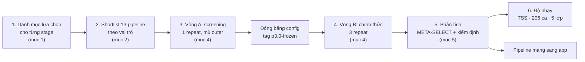

Quy ước trích dẫn: `[R1§4]` là mục 4 của R1. Nguồn mà R1–R3 đánh dấu **[UNVERIFIED]** vẫn giữ nhãn đó ở đây và phải được mở lại trước khi đưa vào báo cáo.

---

## 0. Những gì giữ nguyên từ protocol 2.0

| Thành phần | Giá trị | Lý do |
| --- | --- | --- |
| Cohort | 254 bệnh nhân, 20.531 gene record, 6 lớp (LMS 104, DDLPS 57, UPS 49, MFS 25, SS 10, MPNST 9) | So sánh trực tiếp với Round 1 |
| Biến đổi | `log2(x+1)` trên RSEM normalized, theo từng mẫu | Smith 2020: lựa chọn chuẩn hoá ảnh hưởng rất ít tới hiệu năng `[R1§1]`. DESeq2/VST cần raw counts, không có trong dữ liệu |
| Outer CV | 5 fold phân tầng × 3 repeat, seed 42, **dùng lại `results/splits/outer.csv`** | Các pipeline (kể cả 24 cấu hình Round 1) có cùng split nên so sánh được theo cặp `[R2 Recommendations (a)]` |
| Inner CV | 4 fold phân tầng, **dùng lại `results/splits/inner.csv`** | Điều kiện để chọn pipeline bên trong inner CV (mục 5.1) |
| Metric chính | Macro-F1 gộp 254 dự đoán của mỗi repeat; mean và SD qua 3 repeat | Như 2.0; micro-F1 bị LMS chi phối `[R2 Lớp 3]` |
| Integrity | Checksum dữ liệu và split, clean tree, mọi warning đều phải review | Như 2.0 |

### Nested CV hoạt động thế nào (nhắc lại)

Mọi pipeline đều chạy qua đúng khung này. Outer test **không bao giờ** được dùng để fit hay chọn bất cứ thứ gì.

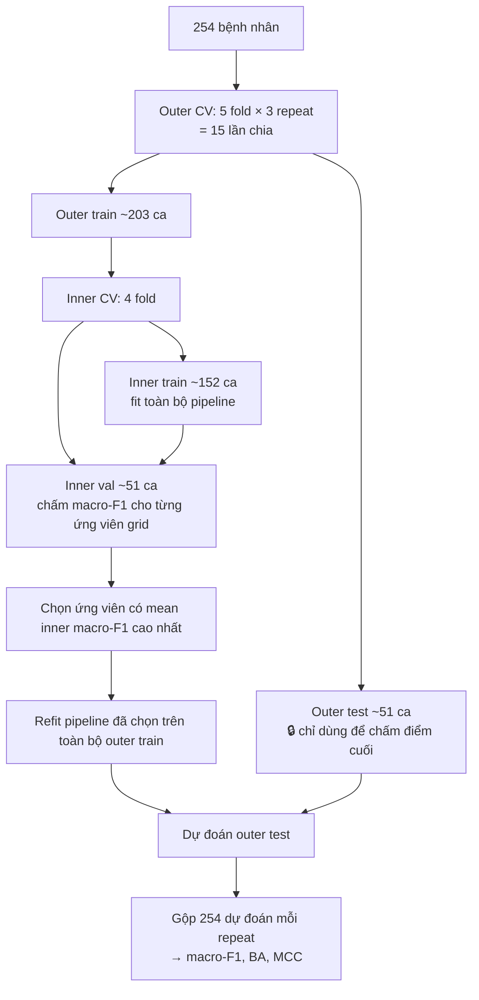

Lớp hiếm trông như thế này trong mỗi tầng (MPNST = 9 ca):

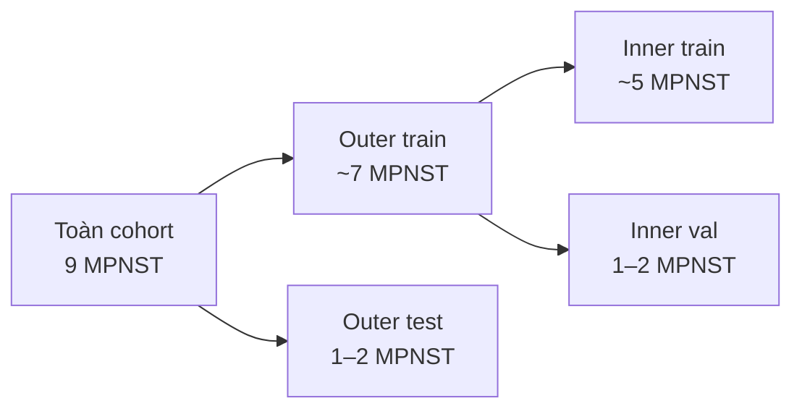

Vì vậy grid phải nhỏ, SMOTE phải có `k_neighbors` ≤ 4, và recall MPNST phải báo cáo kèm khoảng tin cậy.

**Thay đổi so với 2.0:**

1. Thêm metric phụ: **multiclass MCC** `[R2 Lớp 3: Chicco & Jurman 2020]`, và **recall theo lớp có Wilson CI** từ confusion matrix gộp `[R3 Rec. 4]`.
2. Lưu thêm **macro-F1 theo từng outer fold** (15 giá trị) để chạy kiểm định thống kê. Điểm số chính vẫn tính trên dự đoán gộp.
3. Scorer khai báo rõ `zero_division=0`. Fold validation chỉ có 1–2 MPNST nên mô hình có thể không dự đoán lớp này lần nào, và chính sách "mọi warning là lỗi" sẽ dừng run.

---

## 1. Danh mục lựa chọn theo stage

Thứ tự stage: `log2 → (S1) lọc không giám sát → (S2) scaler → (S3) chọn/trích đặc trưng → (S4) xử lý imbalance → (S5) classifier`.

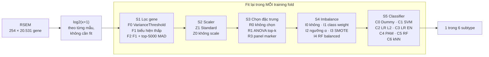

Một pipeline = chọn **một** lựa chọn ở mỗi stage. Ví dụ P02 (Round 1) và P07 (ứng viên chính):

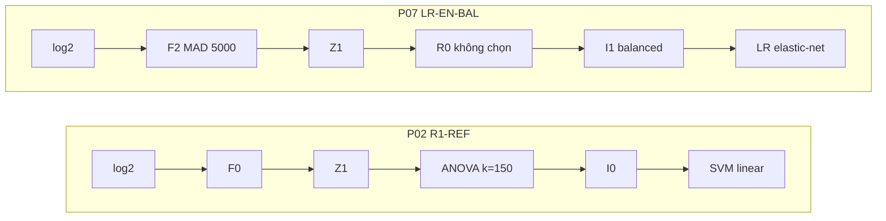

### S1. Lọc gene không giám sát (fit trên training fold)

| Mã | Lựa chọn | Dùng | Nguồn |
| --- | --- | --- | --- |
| F0 | `VarianceThreshold(0)` | Tham chiếu Round 1 | Protocol 2.0 |
| F1 | Lọc biểu hiện thấp: giữ gene có `log2(x+1) > 1` ở **≥ 5 mẫu training** (ngưỡng tuyệt đối, không theo %) | **Mặc định** | Smith 2020: bộ gene từ ~1,5k đến ~56k cho kết quả gần như nhau `[R1§2]`. Ngưỡng tuyệt đối để không loại gene chỉ bật ở MPNST/SS (9/254 ≈ 3,5%) `[R1§2 Lưu ý]` |
| F2 | F1 + top-N theo **MAD**, N = 5000 (fix, không tune) | Đầu vào cho mô hình dùng nhiều gene | Smith 2020; Ambroise & McLachlan 2002: chỉ bước **có giám sát** gây selection bias nghiêm trọng, nhưng vẫn đặt trong fold `[R1§2]` |
| — | ComBat/ComBat-seq theo TSS/plate | **Loại khỏi main.** Chỉ dùng như phân tích độ nhạy | Nygaard 2016: dùng nhãn làm covariate gây ra khác biệt giả; ComBat-seq thiết kế cho DE (Zhang 2020) `[R1§1]` |

### S2. Scaler

| Mã | Lựa chọn | Dùng | Nguồn |
| --- | --- | --- | --- |
| Z1 | `StandardScaler` | **Mặc định** cho SVM/LR/kNN | R1 shortlist #1–#4 `[R1§7]` |
| Z0 | Không scale | RF (mô hình cây không bị ảnh hưởng bởi scale) | — |
| — | `MinMaxScaler` | Chỉ còn trong 24 run Round 1, không chạy lại | Không có nguồn ủng hộ; Round 1 đã so sánh |

Lưu ý kỹ thuật: ANOVA-F không đổi khi biến đổi affine từng feature, nên đặt scaler trước hay sau ANOVA đều cho cùng tập gene. MAD thì phụ thuộc scale nên **phải tính trên thang log2, trước scaler**.

### S3. Chọn / trích đặc trưng (fit trên training fold)

| Mã | Lựa chọn | Dùng | Nguồn |
| --- | --- | --- | --- |
| R0 | Không chọn, để regularization L2/EN tự xử lý | Ứng viên | Smith 2020; khuyến nghị giai đoạn 3 `[R1§3]` |
| R1 | ANOVA-F `SelectKBest`, k ∈ {150, 500, 1000, 2000} | Ứng viên + ablation kích thước | Haury 2011: t-test/ANOVA đơn giản tốt nhất trong 8 phương pháp; bắt buộc nằm trong fold (Ambroise & McLachlan 2002) `[R1§3]`. Round 1: k 50→150 tăng ~8 điểm macro-F1, chưa rõ đã bão hoà chưa |
| R2 | PCA 50/100/150 | Chỉ còn trong Round 1, không chạy lại | PC đầu bị LMS chi phối `[R1§3]`; Round 1: PCA ≈ 0,70–0,72 so với ANOVA 0,77 |
| R3 | Panel marker cố định (MDM2, CDK4, HOXA11, NEURL1, NPAS1, SCD, JADE2, …) | **Chỉ để diễn giải, không được chọn làm winner** | `[R2 B7]`; R3 cảnh báo các marker này được tìm ra trên chính TCGA-SARC nên không độc lập, kết quả sẽ lạc quan `[R3 Rec. 1]` |
| — | mRMR, SVM-RFE, Boruta, AE/VAE | **Loại** | Haury 2011: wrapper/embedded không thắng filter; Smith 2020: deep representation không giúp; đắt và dễ overfit `[R1§3, §7 "Không nên ưu tiên"]`. Guyon 2002, Kursa 2010 **[UNVERIFIED]** |
| — | GSVA/ssGSEA, phân cấp 2 tầng, TabPFN | **Hoãn sang vòng sau** | Có cơ sở (TCGA 2017; van IJzendoorn 2019; Hollmann 2025) nhưng cần thêm hạ tầng `[R1§7 #5, #6, #8]` |

### S4. Xử lý mất cân bằng lớp

| Mã | Lựa chọn | Dùng | Nguồn |
| --- | --- | --- | --- |
| I0 | Không xử lý | Tham chiếu Round 1 | Blagus & Lusa 2010: nên luôn xử lý khi imbalance không nhẹ `[R1§4]` |
| I1 | `class_weight="balanced"` | **Mặc định** | Pes & Lai 2021 (FS + cost-sensitive) `[R1§4]`; baseline bắt buộc `[R2 Key finding 6]`. Cần ghi rõ là **chưa có bằng chứng** riêng cho lớp < 15 mẫu `[R1§4]` |
| I2 | Điều chỉnh prior/ngưỡng: `argmax_c p(c|x)·π_c^(−α)`, π lấy từ training fold, **một** tham số α ∈ {0; 0,5; 1} | Ablation trên LR | Blagus & Lusa 2013: cut-off adjustment tốt hơn SMOTE; dùng một α chung thay vì 6 ngưỡng vì inner chỉ có ~5 MPNST `[R1§4, §7 #3]` |
| I3 | SMOTE trong `imblearn.Pipeline`, **sau** ANOVA, `k_neighbors=3` | Đối chứng âm | Blagus & Lusa 2013: SMOTE "has hardly any effect" ở dữ liệu chiều cao `[R1§4, §7 #10]` |
| I4 | Bootstrap cân bằng của RF (`balanced_subsample`) | Đi kèm RF | Koelsche 2021 downsample từng bootstrap `[R3 Rec. 5]` |
| — | Random undersampling | **Loại** | Phải hạ LMS từ ~83 xuống ~7 mẫu train, tức bỏ ~90% dữ liệu `[R1§4]` |

### S5. Classifier

| Mã | Lựa chọn | Dùng | Nguồn |
| --- | --- | --- | --- |
| C0 | `DummyClassifier` most_frequent / stratified | Sàn (macro-F1 ≈ 0,097 / ≈ 0,167) | `[R2 B0a, B0b]` |
| C1 | SVC linear | Ứng viên; nối với Round 1 | Statnikov 2005, 2008: MC-SVM tốt nhất trên expression `[R1§5, R2 B3]` |
| C2 | LR multinomial L2 (`lbfgs`) | Ứng viên | Smith 2020; `[R2 B1]` |
| C3 | LR elastic-net (`saga`) | **Ứng viên chính** | R1 ưu tiên số 1; `[R2 B2]`. Zou & Hastie 2005 **[UNVERIFIED]** |
| C4 | Nearest shrunken centroids (PAM) | Baseline omics kinh điển | Tibshirani 2002 `[R2 B4]` (PMID **[UNVERIFIED]**) |
| C5 | Random forest | Baseline phi tuyến | Statnikov 2008 dự báo thua SVM; van IJzendoorn 2019 dùng RF trên TCGA-SARC `[R2 B5]` |
| C6 | kNN | Baseline đơn giản | `[R2 B6]`; là classifier duy nhất mà SMOTE có thể giúp |
| — | SVC RBF | Chỉ còn trong Round 1 | Round 1: RBF ≈ linear, chậm gấp ~2,2 lần; RBF hiếm khi hơn linear khi p ≫ n `[R1§5]` |
| — | LightGBM / gradient boosting | **Loại khỏi 3.0** | Chưa có benchmark đã kiểm chứng trên loại dữ liệu này `[R2 B8]`; cần thêm dependency, và grid đủ nhỏ cho n = 254 thì quá hẹp để boosting thể hiện được |
| — | MLP/deep learning | **Loại** | "NN gives worse results for very small datasets (N<300)" `[R1§5]` |

---

## 2. Shortlist: 13 pipeline lõi + 1 tuỳ chọn

Mỗi pipeline khác pipeline đối chứng của nó ở **một stage**, nên mỗi cặp (cột "So với") trả lời được một câu hỏi. Ngoại lệ: P05 và P09 đổi bộ lọc cùng với bước chọn gene, vì bỏ hoặc thêm ANOVA thì cũng phải đổi cách giới hạn số gene.

| ID | Tên cấu hình | Chuỗi stage | Vai trò | So với → câu hỏi |
| --- | --- | --- | --- | --- |
| P01 | `DUMMY` | log2 → C0 (2 biến thể) | **Sàn** | — |
| P02 | `R1-REF` | log2 → F0 → Z1 → ANOVA k=150 → SVC linear, I0 | **Tham chiếu Round 1**. Đồng thời là regression test: engine mới phải tái tạo đúng 0,772 | Round 1 → engine mới có khớp số cũ không? |
| P03 | `SVM-BAL` | P02 + I1 | Ablation S4 | P02 → class weight có giúp không? |
| P04 | `SVM-BAL-K` | P03, nhưng k ∈ {150, 500, 1000, 2000} (vẫn F0) | Ablation S3 (kích thước) | P03 → nhiều gene hơn có giúp không? |
| P05 | `SVM-BAL-MAD` | log2 → F2 → Z1 → SVC linear, I1 (không ANOVA) | Ablation S3 (có/không chọn có giám sát) | P04 → có cần ANOVA không? |
| P06 | `LR-L2-BAL` | log2 → F2 → Z1 → LR L2, I1 | Ứng viên, R2 B1 | P05 → LR hay SVM? |
| P07 | `LR-EN-BAL` | log2 → F2 → Z1 → LR elastic-net, I1 | **Ứng viên chính** (R1 #1) | P06 → thêm thành phần L1 có giúp không? |
| P08 | `LR-L2-PRIOR` | log2 → F2 → Z1 → LR L2 không trọng số, I2 (α tune) | Ablation S4 | P06 → cut-off hay class weight? (α=0 là trường hợp I0) |
| P09 | `LR-L2-ANOVA` | log2 → F1 → Z1 → ANOVA k ∈ {500, 1000, 2000} → LR L2, I1 | Ứng viên (R1 #4) | P06 → ANOVA có giúp LR không? |
| P10 | `LR-L2-ANOVA-SMOTE` | như P09 nhưng I3 thay I1 | **Đối chứng âm** | P09 → SMOTE có hơn class weight không? |
| P11 | `PAM` | log2 → F2 → C4 | Baseline omics | P06 |
| P12 | `RF-BAL` | log2 → F2 → Z0 → RF, I4 | Baseline phi tuyến | P06 |
| P13 | `KNN` | log2 → F1 → Z1 → ANOVA k ∈ {100, 500} → kNN | Baseline đơn giản | P09 |
| P15 *(tuỳ chọn, không được chọn làm winner)* | `MARKER` | log2 → panel marker → Z1 → LR L2, I1 | Diễn giải: "toàn genome hơn vài marker bao nhiêu?" | P06 |

### Bản đồ ablation

Mỗi mũi tên đổi **một** thứ và trả lời **một** câu hỏi. Đọc từ P02 (Round 1) đi xuống.

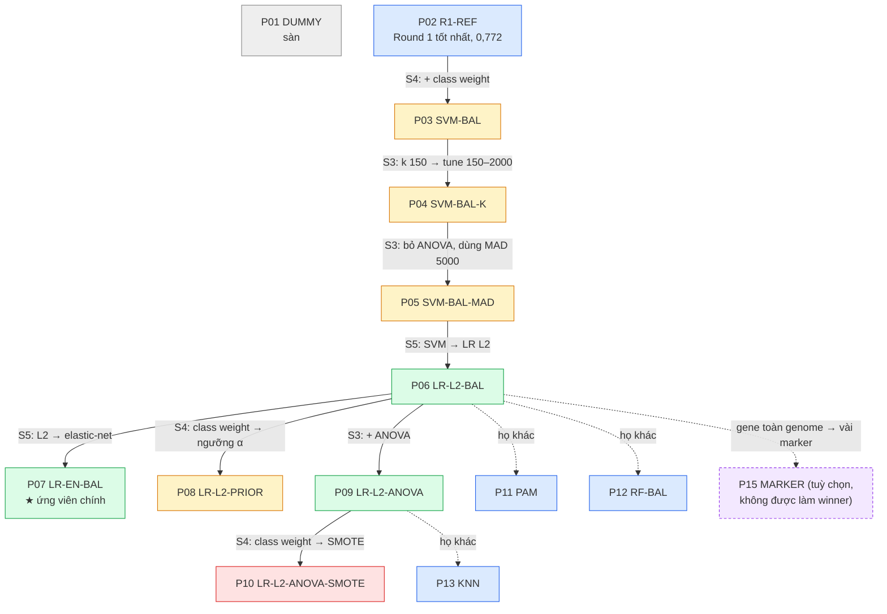

Màu: xám = sàn · xanh dương = tham chiếu/baseline · vàng = ablation · xanh lá = ứng viên · đỏ = đối chứng âm · tím nét đứt = tuỳ chọn. Nét liền = đổi một stage; nét đứt = so với một họ mô hình khác.

**Phân tích độ nhạy** (không phải pipeline mới; chỉ chạy cho winner, P02 và P06 sau vòng chính thức):

- **S-TSS:** outer `StratifiedGroupKFold` nhóm theo TSS. Nếu macro-F1 giảm mạnh thì mô hình đang học TSS `[R1§1]`.
- **S-206:** chỉ dùng 206 ca đã qua pathology review trong Cell 2017 `[R2 Rec. (a)]`, `[R3 Rec. 3]`.
- **S-5CLASS:** gộp MFS+UPS thành 5 lớp `[R3 Rec. 2]`.

S-TSS và S-206 cần bộ split mới, sinh trong cùng quy trình có checksum.

---

## 3. Hyperparameter: cái gì nằm trong inner grid

Nguyên tắc: grid **nhỏ** vì mỗi inner validation fold chỉ có 1–2 MPNST, và lưới lớn làm tăng chệch do chọn mô hình (Cawley & Talbot 2010) `[R1§6]`, `[R2 Rec. (a)]`. Thứ tự khai báo đi từ **regularization mạnh/đơn giản nhất** tới yếu nhất. Khi hoà điểm tuyệt đối thì chọn ứng viên đầu tiên, như 2.0.

| ID | Inner grid (tune bằng `GridSearchCV`, 4 fold, macro-F1) | G | Cố định trong config (không tune) |
| --- | --- | --- | --- |
| P01 | — | 1 | `strategy` (cả 2 biến thể), seed 42 |
| P02 | `C` ∈ {0,01; 0,1; 1; 10; 100} | 5 | k=150, `class_weight=None`, các thiết lập SVC của 2.0 |
| P03 | như P02 | 5 | `class_weight="balanced"` |
| P04 | `k` ∈ {150, 500, 1000, 2000} × `C` (5) | 20 | F0 (giữ như P03 để chỉ đổi một stage) |
| P05 | `C` (5) | 5 | F2 (N=5000) |
| P06 | `C` ∈ {1e-3; 1e-2; 1e-1; 1; 10} | 5 | `lbfgs`, `max_iter`=5000, `tol`=1e-4 |
| P07 | `l1_ratio` ∈ {0,1; 0,5; 0,9} × `C` ∈ {1e-2; 1e-1; 1} | 9 | `saga`, `max_iter`=10000 (chốt sau screening), `tol`=1e-4, seed 42 |
| P08 | `C` (5 như P06) × `α` ∈ {0; 0,5; 1} | 15 | `class_weight=None`; π lấy từ training fold |
| P09 | `k` ∈ {500, 1000, 2000} × `C` (5) | 15 | F1 |
| P10 | như P09 | 15 | SMOTE `k_neighbors=3`, seed 42, đặt sau ANOVA và scaler |
| P11 | `shrink_threshold` ∈ {4; 2; 1; 0,5; 0} | 5 | prior: **uniform** (nhất quán với `balanced`) |
| P12 | `max_features` ∈ {sqrt; 0,01} × `min_samples_leaf` ∈ {3; 1} | 4 | `n_estimators`=500, `balanced_subsample`, seed 42 |
| P13 | ANOVA `k` ∈ {100, 500} × `n_neighbors` ∈ {7; 5; 3; 1} | 8 | `weights="distance"` |
| P15 | `C` (5 như P06) | 5 | danh sách gene khoá trước khi chạy |

Các tham số **cố định ở cấp protocol** (không bao giờ tune): ngưỡng lọc F1 (`log2>1`, ≥5 mẫu), N=5000 của MAD, `k_neighbors` của SMOTE, mọi seed, các thiết lập PCA của 2.0.

**Quy tắc biên grid** (chỉ dùng trong screening): nếu tham số được chọn nằm ở **biên** grid trong ≥3/5 outer fold, mở rộng một bước theo hướng đó **một lần duy nhất** rồi đóng băng. Quy tắc này chỉ dựa vào kết quả chọn của inner CV, không nhìn outer.

**Phụ thuộc mới:** `imbalanced-learn` (cho P10). Phải pin phiên bản tương thích với `scikit-learn==1.7.2`.

---

## 4. Quy trình 2 vòng, số fit và thời gian

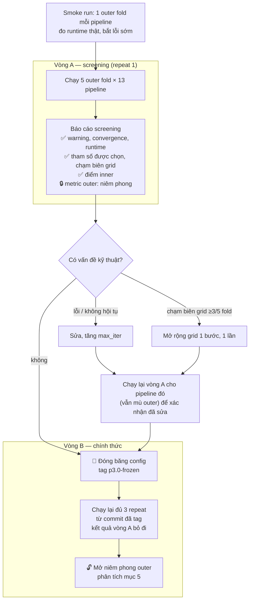

Điều **không** được làm ở vòng A: loại pipeline vì điểm thấp, hay đổi grid dựa vào điểm outer.

### 4.1 Vòng A: screening (1 repeat, "mù outer")

- Chạy **repeat 1** (5 outer fold) cho cả 13 (+1) pipeline.
- Báo cáo screening **chỉ chứa thông tin kỹ thuật và inner CV**: warning/lỗi, convergence, runtime/fit, tham số được chọn, các lần chạm biên grid, điểm inner. **Không ai tính hay xem metric outer** của vòng A. Run folder của vòng A chỉ được lưu trữ để tra lỗi, không đi vào phân tích ở mục 5.
- Vòng A vẫn phải mù dù kết quả của nó bị bỏ: vòng B dùng **cùng split** (`outer.csv`), nên xem outer ở vòng A rồi chỉnh config cũng chính là chỉnh theo test của vòng B.
- Quyết định được phép ở vòng A: sửa lỗi kỹ thuật, tăng `max_iter`, mở rộng biên grid một lần, bỏ một pipeline **chỉ khi** nó không chạy được trong ngân sách thời gian. **Không** loại pipeline theo hiệu năng.
- Lý do: tổng chi phí nhỏ (4.3), nên loại sớm theo điểm số gần như không tiết kiệm được gì mà lại thêm selection bias.

### 4.2 Vòng B: chính thức (3 repeat)

- Đóng băng config bằng một commit (pre-registration: danh sách pipeline, grid, metric, các phép so sánh ở mục 5). Tag `p3.0-frozen`.
- Chạy **đủ 3 repeat** cho mọi pipeline từ đúng commit đã tag. Không tái sử dụng repeat 1 của vòng A: như vậy mọi kết quả chính thức đến từ cùng một phiên bản code, và không cần theo dõi pipeline nào đã đổi config hay chứng minh repeat 1 chưa bị xem. Đổi lại tốn thêm khoảng 1,2 giờ CPU (mục 4.3).
- Sau đó mới mở niêm phong outer và chạy phân tích ở mục 5.

### 4.3 Ước tính số fit

Công thức: mỗi outer fold có `4·G` inner fit + 1 refit, nên mỗi repeat có `5·(4G + 1)` fit. Kiểm chứng với 2.0: SVM linear G=5 cho 15 × 21 = 315 ✓.

| ID | G | Fit / repeat | Ước tính s/fit\* | Thời gian / repeat |
| --- | --- | --- | --- | --- |
| P01 | 1 | 25 | ~0 | <1 phút |
| P02 | 5 | 105 | 0,45 (đo ở Round 1) | ~1 phút |
| P03 | 5 | 105 | 0,45 | ~1 phút |
| P04 | 20 | 405 | 0,5 | ~3 phút |
| P05 | 5 | 105 | 0,5 | ~1 phút |
| P06 | 5 | 105 | 1,5 | ~3 phút |
| P07 | 9 | 185 | 10 (saga, nhiều bất định nhất) | ~30 phút |
| P08 | 15 | 305 | 1,5 | ~8 phút |
| P09 | 15 | 305 | 1,5 | ~8 phút |
| P10 | 15 | 305 | 2 | ~10 phút |
| P11 | 5 | 105 | 0,3 | ~1 phút |
| P12 | 4 | 85 | 3 | ~4 phút |
| P13 | 8 | 165 | 0,3 | ~1 phút |
| **Lõi P01–P13** | | **2.305** | | **~70 phút CPU** |
| P15 (tuỳ chọn) | 5 | 105 | 0,3 | ~1 phút |

\* Một lõi CPU. Mốc duy nhất đo được là SVM linear của Round 1 (138 s / 315 fit ≈ 0,44 s/fit, máy của Member 2). Các con số khác là **giả định** và sẽ được hiệu chỉnh từ smoke run ở vòng A. P07 có thể chậm hơn 3 lần.

| Vòng | Fit (lõi) | CPU ước tính (lõi) |
| --- | --- | --- |
| A: screening (repeat 1) | 2.305 | ~1,2 giờ (khoảng 1–3,5 giờ) |
| B: chính thức, đủ 3 repeat | 6.915 | ~3,5 giờ (khoảng 3–10,5 giờ) |
| **Tổng** | **9.220** | **~4,7 giờ (khoảng 4–14 giờ)** |
| Độ nhạy (3 pipeline × 3 phân tích, mỗi phân tích 1 repeat) | ~1.000 | ~0,5–1 giờ |

So sánh: protocol 2.0 tốn 18.360 fit. Chạy song song theo ứng viên grid (`n_jobs`) trên 4–8 lõi thì mỗi repeat xong trong dưới 1 giờ. Runtime chỉ so được giữa các run trên **cùng một máy**, nên manifest phải ghi lại thông tin máy.

---

## 5. Chọn pipeline thắng mà không bị selection bias

Chọn pipeline có outer score cao nhất trong 13 pipeline rồi báo cáo chính score đó là **lạc quan** (Boulesteix, PMC2813849; Cawley & Talbot 2010) `[R1§6]`, `[R2 Lớp 3]`. Protocol tách ra ba câu hỏi khác nhau.

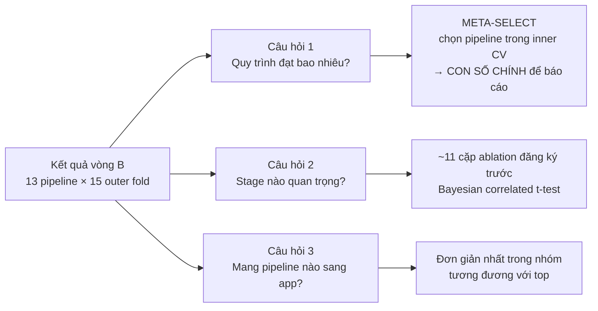

**Vì sao không lấy pipeline có outer score cao nhất rồi báo cáo luôn?** Vì đó là "chọn trên đề thi rồi chấm bằng chính đề thi". Kể cả khi 13 pipeline thực ra ngang nhau, pipeline đứng đầu vẫn có điểm cao hơn thực tế do may mắn.

### 5.1 Câu hỏi 1: quy trình của nhóm đạt hiệu năng bao nhiêu? → **chọn pipeline bên trong inner CV**

Coi lựa chọn pipeline là một hyperparameter. Trong mỗi outer fold:

1. Gom mọi cặp (pipeline, tham số) của các pipeline **được phép làm winner** (P02–P13; không gồm P01 và P15).
2. Chọn cặp có **mean inner macro-F1** cao nhất. Khi hoà, chọn theo thứ tự đơn giản đã khai báo trước: P11 < P03 < P02 < P05 < P04 < P06 < P08 < P09 < P07 < P10 < P13 < P12.
3. Lấy dự đoán outer của chính cặp đó.

Ví dụ cho **một** outer fold (số minh hoạ):

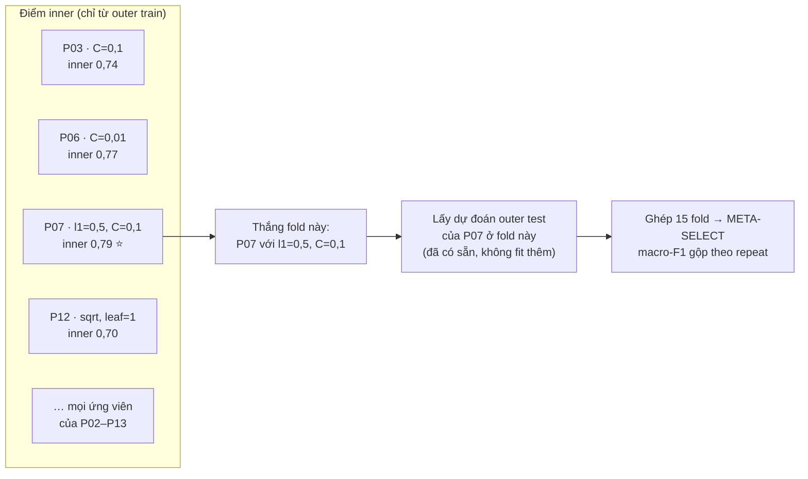

Ở fold khác, pipeline thắng có thể là P06 hay P09. Điều đó bình thường và chính là thứ cần báo cáo (tần suất được chọn).

Vì mọi pipeline dùng **cùng `inner.csv`** và lưu điểm của mọi ứng viên trên mọi fold, bước này **không cần fit thêm**: cặp thắng toàn cục cũng là cặp thắng trong pipeline của nó, nên dự đoán outer đã có sẵn. Kết quả là một bộ dự đoán `META-SELECT` cho 254 × 3 dự đoán. Đây là **con số chính** của dự án: một ước lượng nested gần như không chệch cho cả quy trình "chọn pipeline tốt nhất" (mở rộng lập luận của Varma & Simon 2006 `[R1§6]`). Báo cáo thêm tần suất mỗi pipeline được chọn qua 15 outer fold để thể hiện độ ổn định.

Lưu ý: pipeline có grid lớn có lợi thế nhỏ khi so điểm inner (max trên nhiều ứng viên hơn). Ước lượng outer của META-SELECT vẫn trung thực vì sai lệch này đã nằm trong quy trình. Grid được giữ cùng cỡ (G ≤ 20) để hạn chế việc này.

### 5.2 Câu hỏi 2: stage nào quan trọng? → **các phép so sánh ablation đăng ký trước**

Chỉ kiểm định các cặp đã khai báo ở cột "So với" của mục 2 (khoảng 11 cặp), không so mọi cặp với nhau.

- **Dữ liệu cho kiểm định:** hiệu macro-F1 theo từng outer fold, `d_j` với j = 1..15. Cặp nào cũng ghép được vì cùng split.
- **Kiểm định duy nhất: Bayesian correlated t-test** (Benavoli 2017) `[R1§6]` với **ROPE = ±0,01** macro-F1. Báo cáo P(A tốt hơn), P(tương đương thực tế), P(B tốt hơn). Hệ số tương quan ρ = n_test/n ≈ 0,2.
- Kiểm định này đã hiệu chỉnh cho việc các fold dùng chung dữ liệu train: phương sai được nhân với `1/15 + ρ/(1−ρ) = 1/15 + n_test/n_train ≈ 0,317`, cùng hiệu chỉnh với Nadeau & Bengio 2003 `[R2 Lớp 3]`. Vì vậy không chạy thêm corrected t-test tần suất: hai kiểm định trả lời cùng một câu hỏi, và nếu kết luận lệch nhau thì chỉ thêm việc giải thích. Mục 5.3 cũng dựa trên chính kiểm định này.
- Kết quả là xác suất, không phải p-value, nên không áp hiệu chỉnh Holm. Số phép so sánh được kiểm soát bằng cách chỉ kiểm định ~11 cặp đã đăng ký trước.
- Ghi trước kỳ vọng: với 15 fold, khác biệt dưới khoảng 0,03–0,05 nhiều khả năng **không có ý nghĩa** `[R2 Lớp 3]`. "Không khác biệt" là một kết quả hợp lệ.

### 5.3 Câu hỏi 3: mang pipeline nào sang app/final model? → **quy tắc "đơn giản nhất trong nhóm tương đương"**

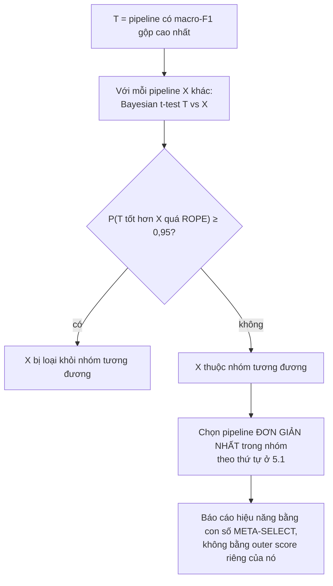

1. Gọi T là pipeline có macro-F1 gộp cao nhất.
2. Tập tương đương gồm T và mọi pipeline mà P(T tốt hơn > ROPE) < 0,95.
3. Chọn pipeline **đơn giản nhất** trong tập đó theo thứ tự ở 5.1. Trong báo cáo, hiệu năng của nó được trích bằng **con số META-SELECT** (5.1), không phải outer score riêng của nó.
4. Tuỳ chọn: chạy xác nhận với một outer seed mới cho top 2–3 `[R1§6 Rec. 2]`. Việc này giảm rủi ro "may mắn do cách chia", nhưng vẫn dùng lại cùng 254 bệnh nhân nên **không phải** validation độc lập. Phải ghi rõ điều này.

**Báo cáo bắt buộc:** tất cả pipeline, không chỉ winner `[R2 Lớp 3]`. Kèm recall MFS/MPNST có Wilson CI, confusion matrix gộp, và tham số được chọn ở mỗi outer fold. Không tối ưu riêng cho MPNST `[R3 Rec. 4]`.

---

## 6. Ràng buộc chống leakage

Nguyên tắc chung: **học trên training fold, chỉ áp dụng lên validation/test fold.** Mọi tham số đi theo một chiều, từ trái sang phải:

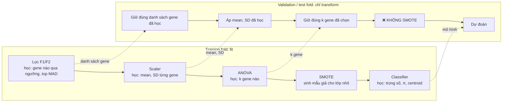

Sai thường gặp: tính MAD, ANOVA hay SMOTE trên toàn bộ 254 ca **trước** khi chia fold. Khi đó test fold đã "nhìn thấy" thông tin từ chính nó và điểm số sẽ đẹp giả.

| # | Ràng buộc | Kiểm tra |
| --- | --- | --- |
| L1 | Mọi bước có `fit` (F1, F2, scaler, ANOVA, SMOTE, prior π, PAM centroid) nằm trong **một** `Pipeline`/`imblearn.Pipeline`, fit lại trên mỗi inner training fold và refit trên outer training | Mở rộng test hiện có "giá trị test không làm đổi preprocessing" cho các transformer mới |
| L2 | **SMOTE** chỉ chạy lúc `fit`, đặt **sau** chọn đặc trưng (Blagus & Lusa 2013), không bao giờ chạm validation/test; `k_neighbors=3` < số MPNST tối thiểu trong inner train (~5) | Test: số mẫu lúc `predict` bằng số mẫu đầu vào; check trước mỗi fit rằng mỗi lớp có ≥ k+1 mẫu |
| L3 | **ComBat** không nằm trong main. Nếu chạy độ nhạy: fit trên training fold, **không** dùng nhãn subtype làm covariate (Nygaard 2016); TSS không có trong training fold thì không áp được | Review code bắt buộc |
| L4 | **Lọc F1/F2** tính ngưỡng và MAD trên training fold, không tính trên toàn cohort | Lưu danh sách gene giữ lại cho từng fold (như `feature_details` của 2.0) |
| L5 | **α và π** (P08) chọn/ước lượng trong inner; không chỉnh ngưỡng theo lớp trên outer | Lưu α được chọn cho từng fold |
| L6 | **Không sửa grid hay pipeline sau khi đã xem outer.** Vòng A mù outer; config đóng băng bằng tag trước vòng B | So hash config với tag `p3.0-frozen` |
| L7 | Dùng lại đúng `outer.csv`/`inner.csv` (checksum). Split mới cho S-TSS và S-206 sinh bằng code có seed và manifest | Như 2.0 |
| L8 | Panel marker (P15) khoá trước; ghi rõ nó **không độc lập** với TCGA-SARC `[R3 Rec. 1]` | P15 không được tham gia META-SELECT |
| L9 | Calibration/score cho app (D11) chỉ fit trong inner, không bao giờ trên outer test `[R1§6]` | — |
| L10 | Không chọn pipeline hay ngưỡng dựa vào metric outer theo lớp (ví dụ recall MPNST) | Quy tắc 5.3 |

---

## 7. Mở rộng thành methodology cho bài toán RNA-seq n nhỏ, p lớn

Các phần không phụ thuộc vào sarcoma, tái sử dụng được:

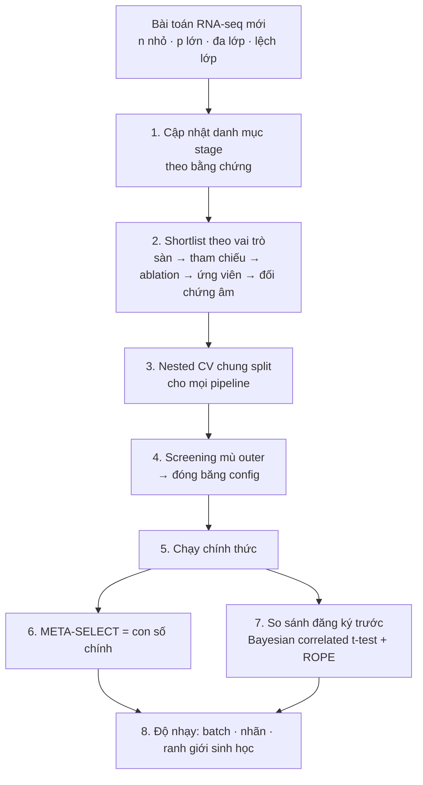

1. **Danh mục stage có trích dẫn** (mục 1). Với bài toán mới chỉ cần cập nhật bằng chứng.
2. **Shortlist theo vai trò**: sàn → tham chiếu → chuỗi ablation từng stage một → ứng viên → đối chứng âm, thay cho full factorial.
3. **Screening mù outer**, sau đó đóng băng config.
4. **Chọn pipeline bên trong inner CV** (META-SELECT) để có con số chính, không cần fit thêm nếu mọi pipeline dùng chung inner split.
5. **Các phép so sánh đăng ký trước**, dùng một kiểm định đã hiệu chỉnh cho repeated CV (Bayesian correlated t-test) với ROPE.
6. **Phân tích độ nhạy theo batch/nhãn/ranh giới sinh học.**

Phần riêng của sarcoma (marker, MFS↔UPS, 206 ca đã review) nằm ở phân tích độ nhạy và phần diễn giải kết quả, nên tách ra dễ dàng.
